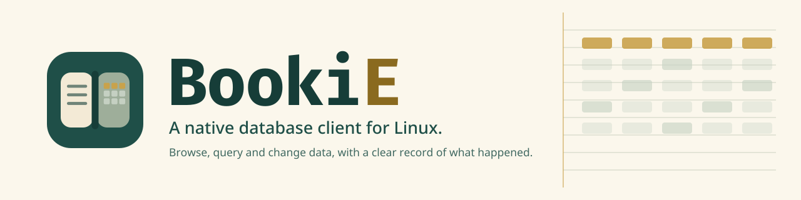
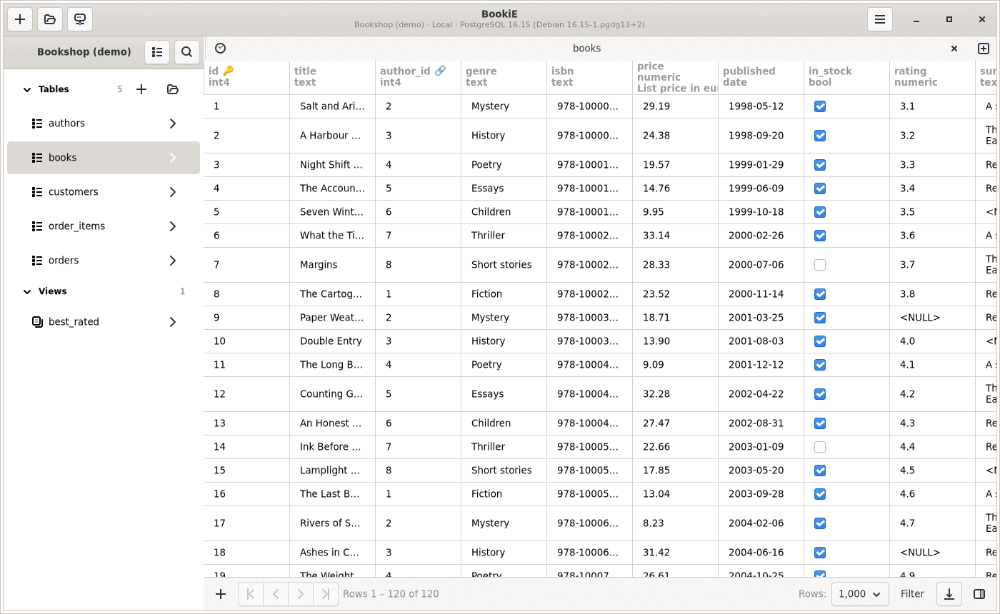
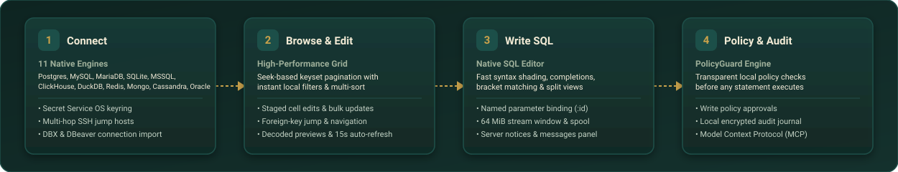
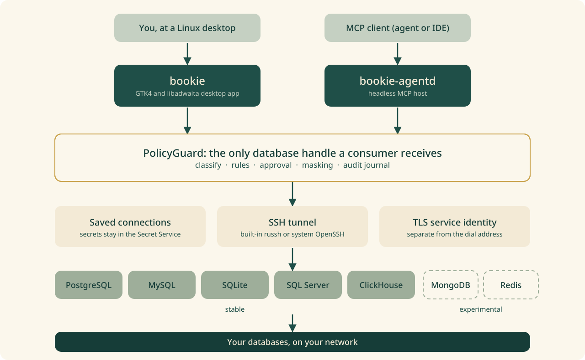

<p align="center">
  <picture>
    <source media="(prefers-color-scheme: dark)" srcset="docs/brand/banner-dark.svg">
    
  </picture>
</p>

BookiE is a free, open-source database client focused on Linux first, built for data analysts, database administrators, and developers. Browse tables, write SQL, investigate results, and review changes in a native desktop workspace. A modern cross-platform GPUI frontend is in active parallel development ([ADR 0052](docs/decisions/0052-gpui-is-the-cross-platform-frontend.md)).

<p align="center">
  <picture>
    <source media="(prefers-color-scheme: dark)" srcset="docs/images/browse-dark.png">
    
  </picture>
</p>

<p align="center">
  
  
  
  
</p>

## Supported engines

<p align="center">
  
  
  
  
  
  
  
  
  
  
  
</p>

## At a glance

| | |
|---|---|
| Platform | Linux first, with a flagship GTK4 and libadwaita desktop interface. Cross-platform GPUI desktop frontend in active parallel development ([ADR 0052](docs/decisions/0052-gpui-is-the-cross-platform-frontend.md)). |
| Databases | **11 engines**: PostgreSQL, MySQL, MariaDB, SQLite, SQL Server, and ClickHouse (Stable). DuckDB (built in), MongoDB, and Redis (Experimental). Read-only Oracle Database and Cassandra / ScyllaDB drivers (Experimental). See the [driver maturity table](docs/adding-drivers.md#driver-maturity). |
| Cost | Free and open source under [AGPL-3.0-or-later](LICENSE). No accounts, subscriptions, license keys, paid tiers, or remote entitlement checks. |
| Credentials | Securely stored in the system keyring (Secret Service via `oo7`). Plaintext files never hold passwords or passphrases. |
| Safety & Governance | Every operation passes local `PolicyGuard` checks and writes to an encrypted audit journal. Destructive actions require explicit confirmation or terminal code approval (`approve <code>`). |
| Interoperability | Native connection draft import from **DBX** (`dbx.db`), DBeaver, DataGrip, Navicat, RESP.app, and Another Redis Desktop Manager. |
| AI agents | Built-in headless `bookie-agentd` server implementing the Model Context Protocol (MCP) over Unix sockets or stdio, guarded by the same safety policy. |
| Performance | Progressive streaming for large results with disk spooling (1 GiB quota, 4,096 pages) and continuous scrolling; fast keyset seeks for table browsing. |

## Highlights and capabilities

- **Spreadsheet-grade data grid**: Fast keyset pagination, customizable page sizes (1–5,000 rows), browse auto-refresh (15s toggle), and page load duration display. Select columns (`Ctrl+Space`), stage multi-cell values (`Set Cells to Value`), enjoy right-aligned numeric data and sticky row-number gutters.
- **Deep value inspection & editing**: **View Value** shows up to 64 KiB rendered text or 16 KiB hex, with decoded previews for supported MessagePack, schema-less Protobuf and image values. **Copy Value** retains complete values; eligible text and JSON edits accept up to 1 MiB.
- **Governed SQL editor**: Side-by-side split view, syntax folding, line bookmarks (`Ctrl+F2`), query history in Open Quickly (`Ctrl+P`), and saved queries organized by folders and search keywords.
- **Server messages & notices**: Bounded PostgreSQL notices/warnings (`RAISE`), SQL Server `PRINT` messages, and MySQL/MariaDB warnings alongside supported statement results. See the [delivery limits](docs/known-limitations.md#interface) for streamed results and scripts.
- **Progressive streaming & comparison**: Supported PostgreSQL SELECTs stream within an estimated 64 MiB row window and 256 MiB shared page budget, spooled to encrypted local cache. Completed saved results support background search and side-by-side comparison with cell change highlighting.
- **Multi-connection workspace**: Open and switch between multiple database connections in a single window with independent per-tab connection routing, environment ribbons (Local, Dev, Staging, Prod), and automatic session restoration.
- **Enterprise SSH tunneling**: Multi-hop SSH bastion chains with up to 8 jump hosts, individual keyring secrets per hop, custom local port binding, and strict TLS verification.
- **Multi-file import with upsert**: Process up to 20 CSV, TSV, or Excel `.xlsx` files in one run, with row updating for existing primary keys on supported engines.
- **Visual schema diagrams & health reports**: Interactive ER diagrams with foreign key links, PostgreSQL table and index bloat/health reports, and one-consistent-snapshot full table exports.

## Install

Install the Arch package or the AppImage from the [latest release](https://github.com/cozyGarage/BookiE/releases/latest). From 0.2.5 onward each release ships only those two artifacts ([ADR 0031](docs/decisions/0031-stop-publishing-the-debian-package.md), [ADR 0032](docs/decisions/0032-stop-publishing-the-flatpak.md)); the [0.2.4 release](https://github.com/cozyGarage/BookiE/releases/tag/linux-v0.2.4) still includes a Debian package and a Flatpak bundle. Library requirements, OpenSSL sonames and install acceptance are in [platforms](docs/platforms.md).

Prefer the Arch package on Arch or Omarchy when OpenSSL 4 is available. Use the AppImage to try BookiE without installing a package, or when the host OpenSSL does not match the Arch package.

To build from source, see [Build and run](#build-and-run).

## First steps



1. Click the `+` in the window header, choose the database type and fill in the connection.
2. Click **Test**, then **Connect**.
3. Click a table in the sidebar to browse it, or press Ctrl+E to open a SQL editor.

The [user guide](docs/user-guide.md) has the full walk-through and the keyboard shortcuts. The [feature list](docs/features.md) shows what BookiE can do, with screenshots.

## Why BookiE?

The name grew out of watching *Peaky Blinders* and thinking about the bookies keeping their ledgers: recording entries, looking them up, and keeping track of changes. There is something familiar in that work for anyone who spends a day with `INSERT`, `SELECT`, `UPDATE`, and `DELETE`.

BookiE is for the people doing that work today. Its purpose is to help you understand your data, maintain your databases, and make deliberate changes with a clear record of what happened.

Open source makes this project possible. BookiE is an independent database client developed with a Linux-first focus, drawing inspiration from the wider open-source database community. Building it is a way to give back through high-performance software, robust safety policy, comprehensive tests, documentation, and shared lessons. Contributions and credit belong alongside the code.

## Status

The documentation describes current source behavior; a merged change may not be in a published package yet. See the [release page](https://github.com/cozyGarage/BookiE/releases) for published artifacts and [release finishing work](docs/backlog.md) for the path to 0.2.8. [Project #3](https://github.com/users/cozyGarage/projects/3) lists selected work. Use the [driver maturity table](docs/adding-drivers.md#driver-maturity), [platform guide](docs/platforms.md), and [known limitations](docs/known-limitations.md) for current engine support, installation requirements, and behavior limits.

## Supported platforms

BookiE is focused on Linux first with its flagship GTK4 and libadwaita desktop application, and cross-platform desktop development is actively underway via GPUI ([ADR 0052](docs/decisions/0052-gpui-is-the-cross-platform-frontend.md)). The [platform guide](docs/platforms.md) lists the current native-library floor and published Linux artifacts.

## Architecture



Every database handle that the desktop app, the MCP tools and `bookie-agentd` receive is a `PolicyGuard`. Token scopes and connection allowlists do not replace it. Drivers are linked at build time and frontends (flagship native GTK4/libadwaita for Linux and cross-platform GPUI) run with no embedded browser. Applications use `bookie-app-services` and `bookie-core` for UI-agnostic application state and service logic.

[`ARCHITECTURE.md`](ARCHITECTURE.md) has the crate map, the request pipeline, trait boundaries and deliberate limits.

## Development

The product repository is [`cozyGarage/BookiE`](https://github.com/cozyGarage/BookiE), and current development is on the `main` branch. BookiE is built with Rust, GTK4, libadwaita, GtkSourceView, Relm4, and GPUI. The root Cargo workspace contains `crates/` and `apps/linux/` and requires Rust 1.98. The GPUI application has a separate workspace in `apps/gpui/`.

Start with the [documentation map](docs/README.md) and [Project #3](https://github.com/users/cozyGarage/projects/3) for selected work and acceptance criteria.

### Independence and system compatibility identifiers

BookiE is an independent, standalone database client with a Linux-first focus, its own autonomous architecture, development lifecycle, and product roadmap.

Installed commands are `bookie`, `bookie-agentd` and `bookie-askpass`. The app ID is `com.bookie.linux` and state lives under `~/.config/bookie/` and `~/.local/share/bookie/`. On first start the app copies state from the legacy `tablepro` locations and keyring entries and leaves the originals in place for rollback ([ADR 0027](docs/decisions/0027-complete-bookie-rename.md)). Cargo packages are `bookie-*`.


## Build requirements

```bash
# Debian testing
sudo apt install -y build-essential pkg-config libgtk-4-dev libadwaita-1-dev \
  libgtksourceview-5-dev libssl-dev libsecret-1-dev libkrb5-dev libsqlite3-dev clang

# Fedora (build from source on a release that meets the toolkit floor below)
sudo dnf install -y gcc pkg-config gtk4-devel libadwaita-devel \
  gtksourceview5-devel openssl-devel libsecret-devel krb5-devel clang

# Arch
sudo pacman -S --needed base-devel pkg-config gtk4 libadwaita \
  gtksourceview5 openssl libsecret krb5 sqlite clang
```

BookiE needs GTK 4.24, libadwaita 1.10 and GtkSourceView 5.22 or newer ([ADR 0021](docs/decisions/0021-toolkit-floor.md)): Arch Linux or Debian testing. Ubuntu and Debian stable releases ship older libraries.

Check the native libraries and Rust toolchain:

```bash
pkg-config --modversion gtk4 libadwaita-1 gtksourceview-5
rustc --version
```

## Build and run

From the repository root:

```bash
# Flagship Linux GTK application
cargo run -p bookie-app

# Cross-platform GPUI application
cargo run --manifest-path apps/gpui/Cargo.toml
```

The first build compiles the bundled DuckDB engine, which takes several minutes.

A plain `cargo run` shares settings, saved connections, the keyring entries and the single-instance lock with an installed BookiE. To keep test data apart, build with the development profile, which uses `~/.config/bookie-devel` and its own keyring schema:

```bash
BOOKIE_PROFILE=development cargo run -p bookie-app
```

Starting a second copy of the same profile asks the running one to show its window and then exits.

### SQL Server Kerberos

Run `kinit` before connecting and confirm the ticket with `klist`. Select **Windows (Kerberos)** in the SQL Server connection form and enter the server's real DNS hostname. SQL Server requests `MSSQLSvc/<host>:<port>`, including when SSH forwards the socket through localhost.

A FILE credential cache works when `KRB5CCNAME` points to a readable location. Custom SPN overrides and cross-realm setup are not exposed in the connection form.

## Validate

Local cheap checks from the repository root:

```bash
bash scripts/preflight.sh
```

`preflight.sh` covers size and panic guards, formatting, Clippy, unit tests on non-GTK crates (it skips `bookie-app`) and the sandbox tier. It does not run the installed GTK suite. Deeper layers (Docker drivers, GTK widgets, installed GTK, release fixture) are documented in [`docs/validation-playbook.md`](docs/validation-playbook.md) and [`docs/testing.md`](docs/testing.md).

From the repository root:

```bash
./scripts/smoke-postgres.sh          # optional smoke against a local PostgreSQL
./scripts/test-postgres-socket.sh    # disposable Unix-socket fixture
```

For manual connection checks across every network driver, use the local-only [manual connection fixture](tests/manual-connections/README.md).

If native development packages are unavailable, `scripts/dev-env.sh` can use Debian-family package payloads extracted under `.local-deps/root/`.

Pull requests run the required automated checks for the proposed revision. Maintainers confirm acceptance before merging; details are in [AGENTS.md](AGENTS.md) and the [validation playbook](docs/validation-playbook.md#ci-tiers).

## Packaging

See the [packaging guide](apps/linux/packaging/README.md) for candidate builds and validation, and [platforms](docs/platforms.md) for release artifacts and package support.

## Documentation

Start at [the documentation map](docs/README.md) for audience and ownership. Common entry points:

| Topic | File |
|---|---|
| Product / personas / principles | [PRODUCT.md](PRODUCT.md), [docs/personas.md](docs/personas.md), [PRINCIPLES.md](PRINCIPLES.md) |
| Capability specs (drafts) | [specs/](specs/README.md) |
| Architecture | [ARCHITECTURE.md](ARCHITECTURE.md) |
| User guide | [docs/user-guide.md](docs/user-guide.md) |
| Feature list with screenshots | [docs/features.md](docs/features.md) |
| Brand: logo, colours, screenshots | [docs/brand/README.md](docs/brand/README.md) |
| Contributing / agent rules | [CONTRIBUTING.md](CONTRIBUTING.md), [AGENTS.md](AGENTS.md) |
| Changelog | [CHANGELOG.md](CHANGELOG.md) |

## Contributing

Read [`CONTRIBUTING.md`](CONTRIBUTING.md) and the rules in [`AGENTS.md`](AGENTS.md). Pull requests for current development target the `main` branch and require all applicable checks before merging.

## Changelog

Published release notes are in [`CHANGELOG.md`](CHANGELOG.md). Unreleased user-facing changes have fragments under [`changelog.d/`](changelog.d/), assembled at the release cut ([ADR 0053](docs/decisions/0053-changelog-fragments.md)).

## License

BookiE is licensed under the [GNU Affero General Public License v3.0 or later](LICENSE).
