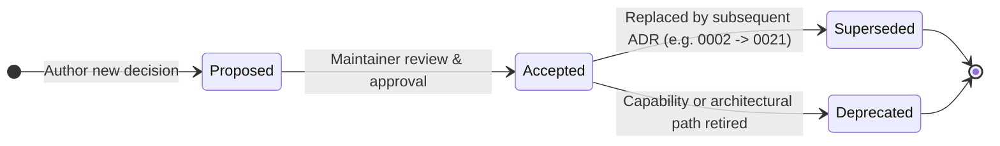

# Architecture decision records

These documents record the reasons behind major technical choices. Accepted decisions stay stable. A later decision may supersede an earlier one by linking to it explicitly.

This index contains accepted decisions.

## Lifecycle



## Format

```markdown
# 000N: Title

- **Status**: Proposed | Accepted | Superseded by 000M | Deprecated
- **Date**: YYYY-MM-DD

## Context

What requires a decision.

## Decision

The selected approach.

## Rationale

Why it fits the project constraints.

## Consequences

Costs and benefits accepted by the project.

## Alternatives considered

Other options and why they were rejected.
```

## Index

| # | Title | Status | Summary |
|---|---|---|---|
| [0001](0001-no-plugin-system.md) | Database drivers are statically linked | Accepted | Driver crates are registered at compile time. |
| [0002](0002-rust-gtk4-libadwaita.md) | Rust, GTK4, and libadwaita | Accepted; toolkit floor superseded by 0021 | Native Linux UI with a virtualized data grid. |
| [0003](0003-relm4-architecture.md) | Relm4 for application architecture | Accepted | Typed component state and async message flow. |
| [0004](0004-libsecret-secret-storage.md) | Secret Service through oo7 | Accepted | Credentials stay in the desktop keyring. |
| [0005](0005-server-side-cancellation.md) | Cancellation must reach the database | Accepted | Drivers report cancellation only when the engine confirms it; unsupported or unconfirmed operations remain unknown. |
| [0006](0006-driver-panic-containment.md) | A driver panic is contained, not trusted away | Accepted | The guard converts a panic to a typed failure; the GUI wakes its monitor, and agentd retires its cached session for replacement on the next acquisition. |
| [0007](0007-type-and-value-preservation.md) | Native type and value preservation | Accepted | One outcome, conversion and proof standard across every driver and consumer. |
| [0008](0008-connection-and-session-ownership.md) | Connection/session ownership and trust | Accepted | Distinct live identities, no pool/replay/security fallback, and scoped uncertainty with durable audit obligations. |
| [0009](0009-persistence-and-identity-compatibility.md) | Durable identity and recoverable state | Superseded by 0027 for identifiers | Stable identifiers, compatible adapters, recoverable migrations and distinct persistence writer contracts. |
| [0010](0010-administrative-action-audit.md) | Audit confirmed bundle administration | Accepted | Bundle import/export use durable, paired aggregate audit records and fail closed before side effects. |
| [0011](0011-paged-query-results.md) | Page large editor results through a cursor | Accepted | Supported single-statement PostgreSQL editor SELECTs stream within an estimated 64 MiB row-storage budget; other paths keep their caps. |
| [0012](0012-sidebar-object-tree.md) | Show database objects in a collapsible sidebar tree | Accepted | Collapsible Tables and Views groups use the existing `GtkListBox`. |
| [0013](0013-multiple-query-result-sets.md) | Preserve every result set from a query | Accepted | Ordered result batches keep SQL Server's later sets under one shared budget; the editor uses a result-set dropdown, MCP preserves sets, and GUI export handles one set |
| [0014](0014-full-table-export-snapshot.md) | Full table exports use one read snapshot | Accepted | Paged exports must read one guarded database snapshot or refuse before publishing a file |
| [0015](0015-database-snapshots.md) | Database snapshots and restore | Accepted | Per-engine native snapshots behind a capability flag, generated names, one guarded and audited operation per action, a safety copy on restore |
| [0016](0016-governed-consumer-seam.md) | PolicyGuard is the only consumer connection | Accepted | Composition roots wrap consumer connections in `PolicyGuard`; the `Arc<dyn Connection>` interface does not encode that invariant as a distinct type |
| [0017](0017-mcp-sdk-behind-the-governed-seam.md) | Official Rust MCP SDK behind the governed seam | Accepted | Target: replace the hand-written protocol and transport layer while keeping tokens, allowlists, approval and audit in BookiE's code. |
| [0018](0018-headless-app-services-crate.md) | Headless application-services crate | Accepted | GTK-free services have moved into `bookie-app-services`; remaining `apps/linux/app/src/services/` modules are shell-owned adapters and composition. |
| [0019](0019-database-tooling-without-sidecars.md) | Database tooling without sidecars | Accepted | DuckDB for file conversion, `refinery` behind `PolicyGuard` for migrations, supervised vendor dump tools for backup; no sidecar binaries |
| [0021](0021-toolkit-floor.md) | Support only the newest GTK toolkit | Accepted | GTK 4.24, libadwaita 1.10 and GtkSourceView 5.22 at startup, build, package and CI; older distributions are unsupported |
| [0022](0022-release-notes-from-merge-commits.md) | Release notes come from merge commits | Accepted | A `Release-Note:` trailer on each squash commit replaces edits to `CHANGELOG.md`; notes are assembled at release. |
| [0023](0023-system-openssh-transport-boundaries.md) | System OpenSSH transport boundaries | Accepted | Askpass answers only exact prompts, forced client options, no global state, and no `core` dependency in the ssh crate. |
| [0024](0024-keyed-grid-writes-check-what-they-overwrite.md) | Keyed grid writes check what they overwrite | Accepted | Relational updates compare edited columns' original values and must affect exactly one row; MongoDB guards by field and row; deletes and ABA are limits. |
| [0027](0027-complete-bookie-rename.md) | Complete the BookiE rename and copy legacy state forward | Accepted | Every identifier becomes `bookie`; legacy state, keyring entries and bundles are carried forward without rewriting. |
| [0028](0028-isolated-frontend-experiments.md) | Isolate frontend experiments from the shipped application | Accepted | Synthetic frontend experiments remain separate from the shipped GTK application and real data. |
| [0025](0025-transient-result-page-spool.md) | Keep fetched result pages in a transient spool | Accepted | A private, bounded, encrypted spool makes every fetched PostgreSQL page revisitable without retaining all rows in RAM or rerunning SQL. |
| [0029](0029-whole-result-operations-on-the-spool.md) | Operate on a completed streamed result through the spool | Accepted | Find and Filter scan the encrypted spool without SQL; a filter writes its own derived spool. |
| [0030](0030-audit-local-result-comparison.md) | Audit local result comparison | Accepted | A confirmed result comparison writes a paired aggregate audit record without values. |
| [0031](0031-stop-publishing-the-debian-package.md) | Stop publishing the Debian package | Accepted | Releases stop building the Debian package because the toolkit floor excludes stable Debian and Ubuntu; the staging builder stays for the AppImage. |
| [0032](0032-stop-publishing-the-flatpak.md) | Stop publishing the Flatpak | Accepted | Releases ship only the Arch package and the AppImage; the Flatpak manifests, scripts and workflow are removed. |
| [0034](0034-postgres-metadata-visibility-for-restricted-roles.md) | Metadata visibility for restricted PostgreSQL roles | Accepted | Show only objects the role can reach, by one privilege-aware rule in SQL across the sidebar, completion, ER diagram, compare, MCP and statistics tools. |
| [0035](0035-schema-compare-opt-in.md) | Same-engine schema compare ships opt-in | Accepted | Keep the compare code, show its menu entry only when `BOOKIE_SCHEMA_COMPARE` is set until the dialect and DDL profile ADR exists. |
| [0036](0036-experimental-frontends-may-read-a-disposable-sqlite-fixture.md) | Experimental frontends may read a disposable SQLite fixture | Accepted | An experiment may read one SQLite file it creates itself, read-only, with no user path, credentials or network. |
| [0037](0037-results-crate-split.md) | Split the pure result logic into `bookie-results` | Accepted | Move compare, filter, find, predicate, scan, spool, exact values and the sidebar tree into a crate that depends only on `core`; app-services re-exports them. |
| [0038](0038-audit-sql-hash-key.md) | Key the audit journal's SQL hash | Proposed | Use a per-install key and HMAC-SHA-256 for `sql_hash`, so a leaked journal cannot be matched against candidate statements. |
| [0039](0039-gpui-source-for-experiments.md) | GPUI source for the experimental frontends | Accepted | Pin `gpui-pre` and `gpui-kit` as an exact pair instead of crates.io `gpui 0.2.2`; the spike port passes all 77 tests. |
| [0033](0033-frozen-result-grid-columns.md) | Frozen leading columns in the result grid | Proposed | GTK4 has no frozen columns; the options are two synced column views, a custom list-view grid, or not freezing, with a spike to decide. |
| [0040](0040-multi-session-window-workspace.md) | Multi-session windows keep a headless workspace model | Accepted | A window may hold several PolicyGuard-backed sessions; tab↔connection maps and restore live in app-services; Relm4 stays the Linux shell. |
| [0041](0041-frontends-render-services-decide.md) | Frontends render; app-services decides | Proposed | Result paging, find, filter, edit tracking and driver capabilities live in UI-free crates; GTK and experimental frontends hold view state only, and a script checks experiment dependencies. |
| [0042](0042-dbx-visual-reference-for-gpui.md) | dbx is the visual reference for the GPUI experiment | Proposed | The GPUI experiment follows dbx's tokens, density and layout under its Apache-2.0 licence, without its branding; GTK stays libadwaita. |
| [0043](0043-gpui-frontend-may-read-real-data-through-app-services.md) | The GPUI frontend may read real data through app-services | Accepted | Lift ADR 0028 and 0036 for reads only, through app-services and PolicyGuard, with typed values, Secret Service credentials and audit; writes and shipping need later decisions. |
| [0044](0044-gpui-app-lives-under-apps.md) | The GPUI app lives under apps/ | Accepted | Move it from experiments/ to apps/gpui as bookie-gpui with the same dependency rule; moving it is not shipping it. |
| [0045](0045-network-checks-crate.md) | TCP checks with history live in a UI-free crate | Accepted | `bookie-checks` holds `check_tcp` and a bounded `History` with a summary; HTTP checks, scheduling and persistence follow separately. |
| [0046](0046-pg-sessions-crate.md) | PostgreSQL sessions and locks live in a UI-free crate | Accepted | `bookie-pg-sessions` lists sessions with waits and blocking pids and ranks blockers; reads only, terminating a backend is a separate decision. |
| [0047](0047-redis-pubsub-sample.md) | Redis pub/sub is read as a bounded sample | Proposed | `sample_pubsub` subscribes by pattern and returns after N messages or a time window; a continuous monitor, streams and LISTEN/NOTIFY are separate. |

Three records use "snapshot" for different things: ADR 0011 a read-only snapshot session, ADR 0014 the read snapshot a full export holds, and ADR 0015 a saved copy of a database.

Decisions 0007–0009 extract established product and compatibility rules. Accepted means the architecture choice is recorded; implementation and acceptance remain separate from the decision itself.

## Adding a decision

1. Use the next number.
2. Copy the format above into a lowercase dash-separated filename.
3. Keep the document focused on one decision.
4. Add it to the index in the same change.
5. Submit it through the normal review process.
6. Record every rejected alternative with its reason under **Alternatives considered**. A dated review that declines something is not a decision record until it is here.
7. A limitation entry never overrides an accepted ADR. If shipped behaviour differs from an ADR, fix the behaviour or record a new ADR that supersedes it.
8. After acceptance, edit an ADR only to clarify its wording. Keep progress in the project tracker and run-specific measurements or acceptance evidence in private verification records, not in an ADR.
