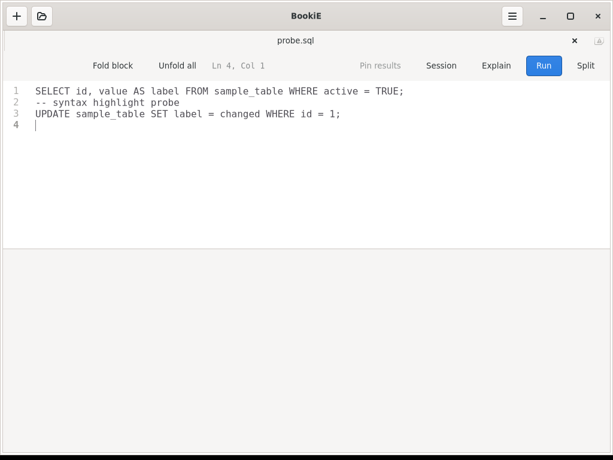
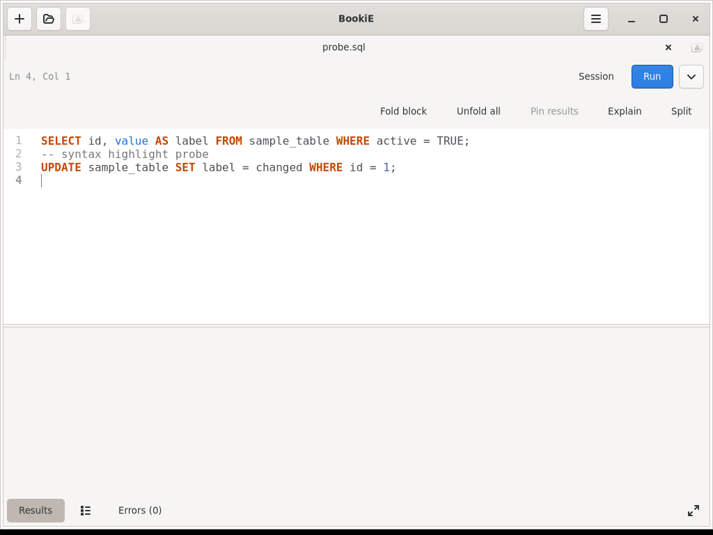

# AppImage SQL highlighting

Source commit: `59bdfb60a2add8fc9abcc7ae7fb17bc31dea465c`, based on Linux `4b04d3bf73f7221e4cdf37ee6bd5b98d0672c789`.

## Acceptance scenario

Given a clean Debian testing container without `/usr/share/gtksourceview-5`, when the AppImage is launched and a `.sql` file is opened in the editor, SQL keywords are syntax highlighted. The result is checked in the rendered editor, not inferred from the language manager returning a language object.

The previous `linux-v0.2.0` AppImage rendered the same probe as plain text. The new build renders SQL keywords in the editor's syntax colors. The comparison uses `probe.sql` from the local test fixture and does not require a database connection.

## Build and runtime evidence

- The AppImage was built from source commit `59bdfb60a2add8fc9abcc7ae7fb17bc31dea465c` with the release workflow's Debian testing dependencies and Rust 1.98.1.
- The AppImage SHA256 is `4b9b49fb64eab16f1f331564612cf210cda07b9519f5e1ae8bbb3758ddb025f1`.
- Debian's `libgtksourceview-5-common` supplies `language-specs/language.rng`. GtkSourceView logged that it could not load the embedded SQL language specification when this schema was absent, even though its library and language resource were present.
- The build workflow now installs that package, and `build-appimage.sh` stages `/usr/share/gtksourceview-5` and fails if `language.rng` is missing.
- The test container had no host GtkSourceView data directory. `/proc/<pid>/maps` showed GtkSourceView loaded from the extracted AppImage; see [the process map](sourceview-library-map.txt).
- The fixed run log had no `GtkSourceView-WARNING` messages.

## Screenshots

The screenshots show the same SQL probe in the previous release and the rebuilt AppImage:

The previous artifact SHA256 was `42583551f61b022773c498cdd6e938b3caa51919f2c29fd807b98666f360287d`, matching the public release checksum. This local build confirms the clean Debian AppImage behavior; it is not a new release or native Arch installation acceptance.
