# BookiE features

This page describes current BookiE behavior. Published artifact versions and package requirements are listed in [platforms](platforms.md). Steps and shortcuts are in the [user guide](user-guide.md). Limits are in [known limitations](known-limitations.md). Per-engine capabilities are in the [driver maturity table](adding-drivers.md#driver-maturity).

## Databases

| Engine | Maturity | Notes |
|---|---|---|
| PostgreSQL | Stable | Broadest test coverage, including server-confirmed cancellation and verified TLS through SSH. |
| MySQL and MariaDB | Stable | Unix socket connections are supported. |
| SQLite | Stable | File based. Additional database files can be attached under custom schema aliases. |
| SQL Server | Stable | Kerberos sign-in is available. |
| ClickHouse | Stable | Mutations are awaited, so saved edits show up in the grid. |
| MongoDB | Experimental | Collections, find and aggregate. An optional authentication database can be set. |
| Redis | Experimental | One host and port. Sentinel and Cluster are not supported. |
| DuckDB | Experimental | Built in. |
| Cassandra / ScyllaDB | Experimental | Read-only browsing and SELECT queries over plain TCP, on the one node you connect to. TLS, writes, row offsets beyond 100,000 and server-side cancel are not available. |
| Oracle Database | Experimental | Read-only browsing and SELECT queries over plain TCP. TLS, writes and server-side cancel are not available. |

Drivers are linked at build time. There is no plugin system ([ADR 0001](decisions/0001-no-plugin-system.md)).

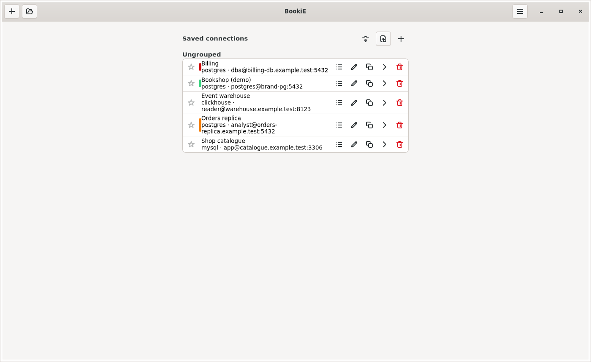

## Connect

- The welcome screen offers up to three recently opened connections, with their driver and environment shown on each card.
- Saved connections keep passwords in the desktop keyring (Secret Service), not in BookiE's own files.
- SSH tunnels use the built-in client or the system OpenSSH. BookiE asks before trusting an unknown host key.
- The built-in SSH client can go through a chain of up to eight hosts. Add, reorder and remove jump hosts in the connection form; their passwords and key passphrases are kept in the desktop keyring, one entry per host.
- One window can hold several open connections. Opening another saved connection adds its tabs to the same tab bar, and each tab says which connection it belongs to while more than one is open. The selected tab decides which connection the header, the sidebar and Safe Mode show. Saving, loading and exporting from a tab always use that tab's own connection. Closing the window asks once about unsaved changes in every connection and names them; Save writes each tab to its own connection and Cancel keeps every connection open. Disconnect closes one connection and its tabs. A connection that fails to open reports the error without disturbing the others. Each window reopens its connections at the next start.
- TLS has several strictness levels, up to checking both the certificate authority and the host name.
- Each connection has an environment: Local, Dev, Staging or Prod. A Prod connection shows a red badge, a tinted header and `[Production]` in the window title.
- A read-only connection refuses every change.
- SQLite connections support attaching additional database files under custom schema aliases, enabling cross-schema queries and unified catalog browsing.
- The sidebar Catalog group lists functions, procedures and triggers (and the other catalog kinds the engine supports). Click a kind to load its objects under it, up to 200 shown; schemas hidden in the sidebar filter stay hidden. Click an object, or "Show all in Catalog…", to open the Catalog dialog on that kind.
- A connection can be filled from a URL such as `postgres://user@host:5432/db`.
- Connections can be exported and imported. An export encrypted with a passphrase includes stored credentials. A plaintext export contains none.
- Connection drafts can be imported from DBeaver `data-sources.json`, DataGrip `dataSources.xml`, Navicat `.ncx`, RESP.app (Redis Desktop Manager) `connections.json` and Another Redis Desktop Manager exports. Host, user and engine are filled; passwords are never read from those files. Save each draft to store credentials in Secret Service. DBeaver and DataGrip folders become nested connection groups when present.
- Saved connections can live in nested groups (for example `Prod / EU`). The welcome list shows the hierarchy and can collapse or expand each folder. Organisation stays in the local sidecar beside `connections.json`; connection files never gain secrets.

## Browse and edit tables

<picture>
  <source media="(prefers-color-scheme: dark)" srcset="images/browse-dark.png">
  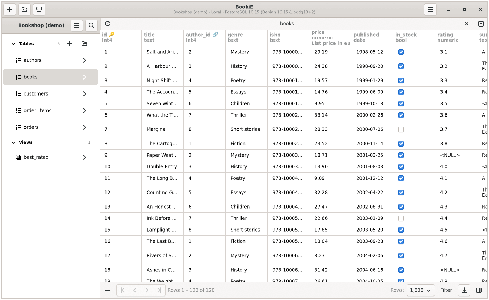
</picture>

- Click a table or view in the sidebar to open it in a preview tab. Edit or keep the tab to make it permanent.
- Tables are read in bounded pages. Deep forward navigation uses primary-key seeks where supported; previous-page, last-page and explicitly sorted paths may use offsets on some engines. See [known limitations](known-limitations.md#data-and-values).
- Edit a cell with a double-click, F2 or Enter. Edits stay pending, with a dot on the tab, until Ctrl+S. Undo and redo apply to pending edits.
- On PostgreSQL, a view that is automatically updatable, maps to one table and exposes every primary-key column of that table opens editable, through the same staged edits, approval and audit as a table. Insert is offered only when the view accepts inserts. A view with an INSTEAD OF trigger or rule, an aggregate, a join or a missing key column stays read-only and says which of these applies. MySQL, MariaDB and SQL Server views stay read-only ([#2203](https://github.com/cozyGarage/BookiE/issues/2203)).
- Insert rows, delete rows and set a cell to NULL. Changes are saved in one transaction where the engine supports it.
- NULL, empty text and unsupported values look different. Booleans show a check box with a third state for NULL. Sparse document fields that an object lacks show as (missing) and remain distinct from NULL.
- The header shows each column's type. Primary key columns have a key mark, foreign key columns a link mark, and a column comment appears under the name.
- Filter with the filter bar, and save filters by name per table. Sort by clicking a header; click further headers to add local secondary sort keys on the loaded page, and clear sort from the header menu or pager.
- Foreign key navigation is bidirectional: **Go to Referenced Row** opens the parent table, and **Show Referencing Rows** navigates to matching child records in referencing tables with pre-populated filters.
- Copy selections in multiple formats: CSV, CSV with headers, Markdown, Text Table (aligned ASCII borders with right-aligned numeric cells), JSON Lines, and Values List (SQL multi-row tuples with dialect-specific syntax).
- Select whole columns from the header menu or with Ctrl+Space. Copy, **Copy as** and the selection statistics then act on those columns over the loaded rows, and the status bar offers TSV, CSV, JSON and IN list copies of the current selection.
- **Set Cells to Value** stages one typed value or NULL into the selected cells of a keyed, editable browse table. Key and generated columns, NULL into NOT NULL columns and values that do not fit the column type are refused before anything is staged; the change then follows the normal Save path. Query result grids support column selection and Copy as but not Set Cells to Value.
- **Table and Index Health** (PostgreSQL only, next to Server Activity in the main menu) runs fixed read-only reports from built-in statistics: dead rows with size and last vacuum and analyze, estimated bloat, unused indexes, duplicate or overlapping indexes and tables read mostly by sequential scans. Each report shows at most 50 rows, can be cancelled by closing the dialog, goes through the same policy and audit path as any read and skips schemas hidden in the sidebar and objects the role cannot see. A row can copy a ready-made `VACUUM` or `DROP INDEX CONCURRENTLY` statement or open it in an editor tab. The statement is never run for you.
- Hide and reorder columns, and reset dragged column widths. The choice is remembered per table.
- Long cells over 8 KiB show a preview and byte count. **View Value** displays up to 1 MiB rendered text or 16 KiB hex. **Copy Value** copies complete values. Eligible text and JSON cells can be edited in the full-value dialog with semantic JSON formatting.
- **View Value** adds a read-only **Decoded** section below the hex dump when binary bytes are valid MessagePack, or look like schema-less Protobuf (shown by field number, as a best guess). Other bytes show the hex dump only. The preview never replaces the bytes that **Copy Value** copies.
- The row inspector lists every column and its type. Selection statistics show count, sum, average, min, and max across numeric columns.

### Filters and search

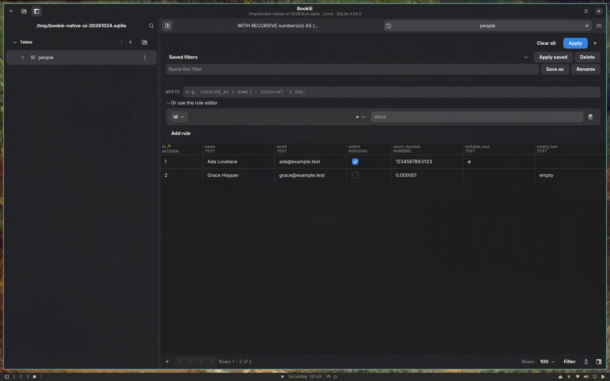

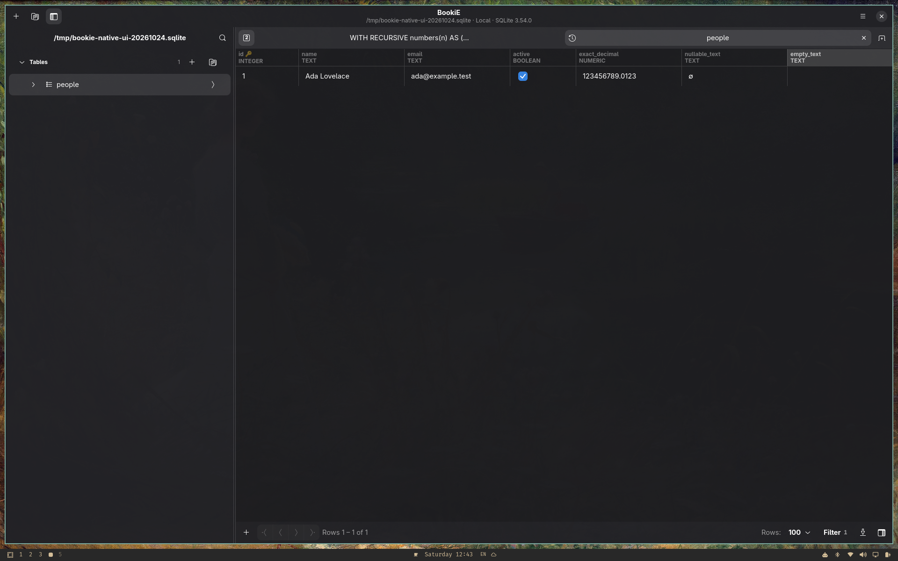

## Write SQL

<picture>
  <source media="(prefers-color-scheme: dark)" srcset="images/sql-editor-dark.png">
  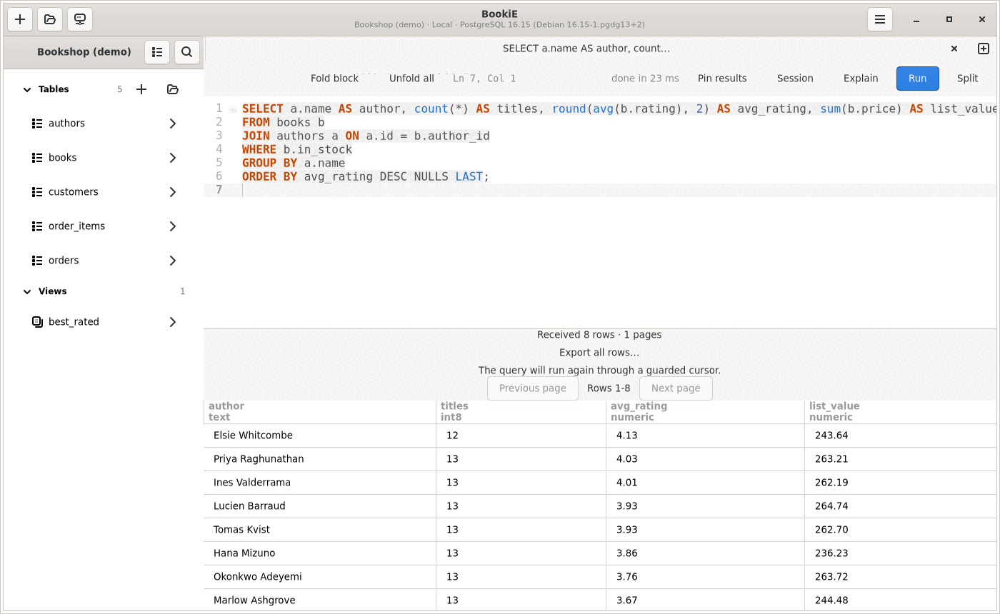
</picture>

- Ctrl+E opens an editor tab. Ctrl+Enter runs the selected text, or the whole script when nothing is selected. Ctrl+Shift+Enter runs the statement at the cursor. Escape cancels a running query when the server supports it. Ctrl+Alt+G focuses the active query or browse result grid (and reopens a hidden Results panel); Ctrl+Alt+E returns focus to the SQL editor.
- Syntax highlighting, code folding, line bookmarks and a side-by-side split of the same query.
- Server messages: PostgreSQL `NOTICE` and `WARNING`, SQL Server `PRINT` and low-severity `RAISERROR`, and MySQL or MariaDB warnings show in a Messages section under the statement's result, with severity, code and text, a Copy button and a count in the status line. The status line tooltip shows the run time and any approval wait. See [known limitations](known-limitations.md#interface) for the bounds.
- Completion offers keywords, tables after `FROM` and `JOIN`, and the columns of the tables named in the statement. `alias.` and `table.` narrow the list. Chosen names are inserted quoted for the engine.
- Bound parameters: Write `:name` in queries; BookiE prompts for typed values before execution without string concatenation.
- Progressive streaming: Single-statement PostgreSQL `SELECT`s stream within an estimated 64 MiB row budget; overflow pages spill to a local encrypted spool so previous pages remain revisitable without re-running SQL. The first page stays selected while rows arrive, and the result shows whether it is receiving, complete or incomplete. The newest page and the page currently being viewed remain in memory while later pages arrive; if a stream times out or is cancelled, received pages stay selected. After successful completion, Export all rows reads the stored result without executing the query again.
- Local sort and filter: Sorting and filtering loaded query results are local and do not re-execute SQL. Multiple column headers stack as local sort keys on the loaded rows; clear sort restores load order.
- Whole-result Find and Filter: Once a streamed result is complete, **Find in all rows** searches every saved page in the background (up to 10,000 matches, with Cancel), with match case, whole words, regular expression and column scope. It steps through matches with the match buttons and loads the page that holds each one. **Show matching rows** copies the matching rows into a new encrypted result with its own paging, continuous scrolling, pinning and Export all rows. Neither runs SQL again. Page-local Replace for keyed editable text cells is available from **Find in Loaded Rows**.
- Cell filter: the cell menu of a completed streamed result filters all saved rows to those equal, or not equal, to the cell's exact typed value.
- Compare results: **Compare…** diffs two complete results from one connection. Without a key it compares whole rows and ignores order; with chosen key columns it also shows changed rows as Before and After and highlights the cells that changed. NULL, empty text and empty bytes stay different, and a comparison records an entry in the audit journal.
- Session mode: Binds tabs to dedicated connections for temporary tables and transactions, displaying live transaction state.
- Visual explain plans: PostgreSQL displays execution trees with relative cost bars; SQLite displays indented trees.
- Timeout retry: Queries that hit timeouts offer an instant extended retry button.
- Query history & favorites: Toggle history with `Ctrl+H`, save favorites with `Ctrl+D`, view favorites with `Ctrl+Shift+B`, and use Open Quickly with `Ctrl+P`.

### Split editor and streaming

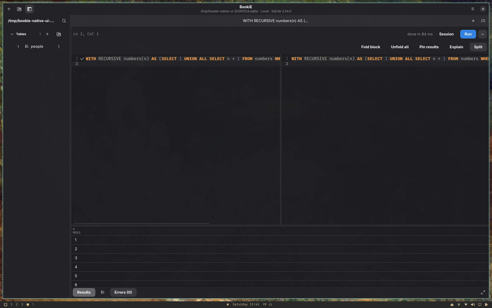

<picture>
  <source media="(prefers-color-scheme: dark)" srcset="images/stream-pager-dark.png">
  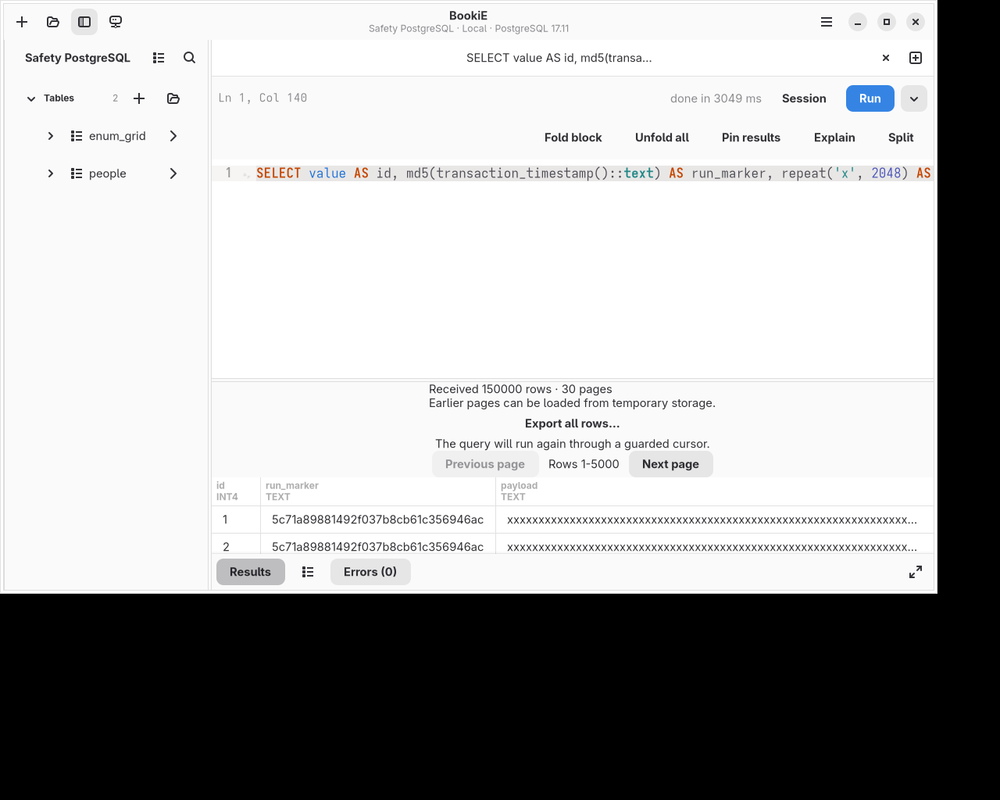
</picture>

## Tables and structure

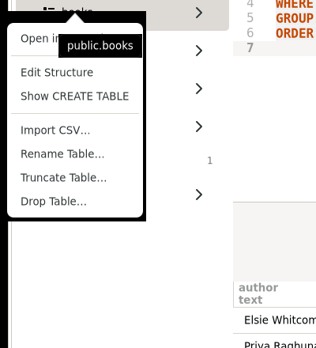

The sidebar table menu has Edit Structure, Show CREATE TABLE, Show ER Diagram, Import CSV, Rename Table, Truncate Table and Drop Table.

- Edit Structure has tabs for columns, indexes and foreign keys, and an SQL Preview tab.
- Rename Table is refused while the table has open tabs, so no pending change is lost.
- Truncate Table asks for confirmation and runs through the same guard as every other statement. SQLite does not support it.
- Show ER Diagram (also on a schema row) draws the schema's tables as cards with their columns, key badges and foreign-key relations. It reads at most 150 tables with the connection's metadata calls, under the operation timeout, and can be cancelled. Pan by dragging, zoom with the buttons or Ctrl+scroll, and pick a table in the list to centre it. Cards are laid out automatically; they cannot be moved, and the diagram cannot be exported yet.

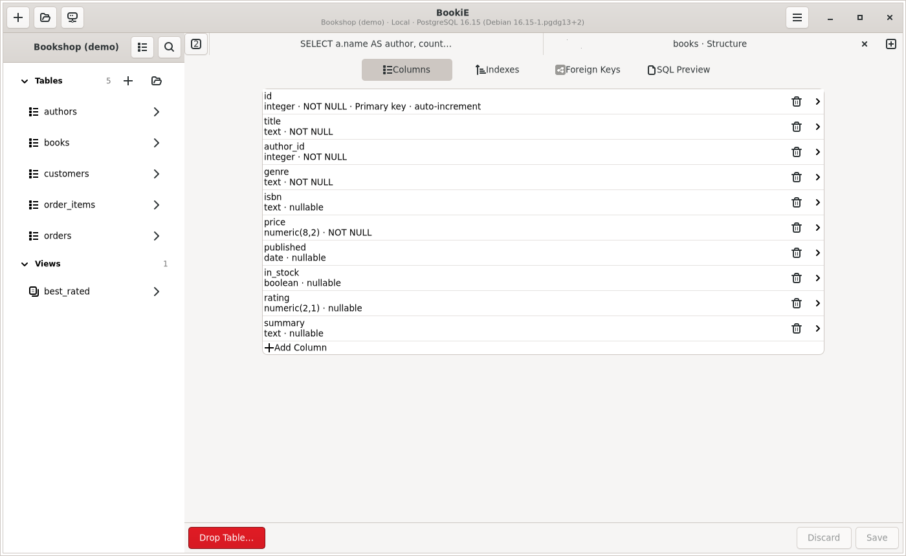

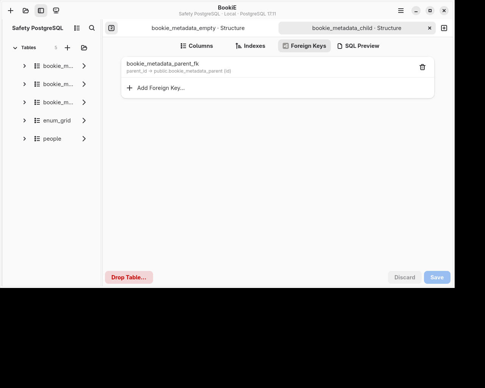

## Import and export

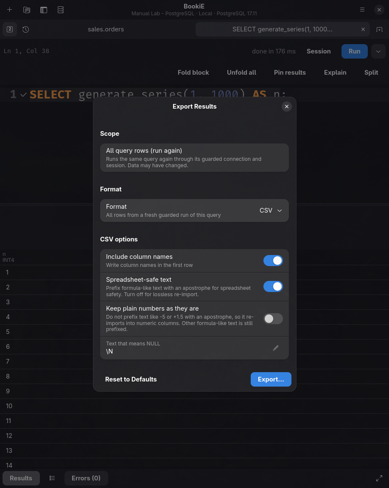

- Export a table page or a query result as CSV, JSON, Markdown, HTML, XML, SQL or an Excel workbook. Ctrl+Shift+E exports the front tab's shown rows. On PostgreSQL, a table can also be exported in full from one consistent read snapshot.
- CSV export can protect cells that start like formulas, and can keep plain numbers unprotected so they import back into numeric columns.
- Import CSV into an existing table, or create a new table from a CSV file. Separator, header row and column mapping are detected and can be changed. The quote character, backslash escaping and file encoding (UTF-8, Windows-1252, UTF-16) can be set.
- Import accepts Excel `.xlsx` files. The first worksheet with data is read.
- Mappings can be remembered per connection and table.

## Safety and records

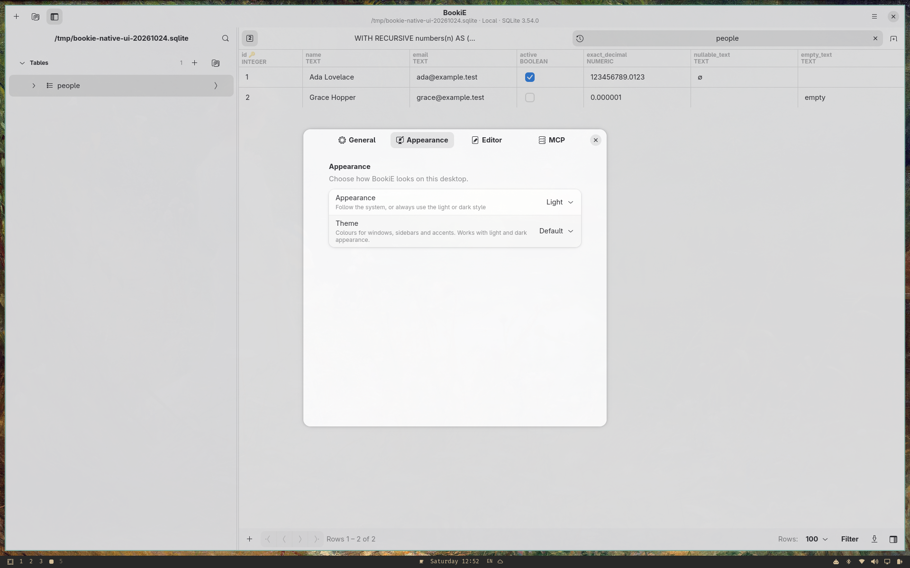

- Every statement is checked before it runs. Writes on a read-only connection are refused.
- Depending on the environment and policy, risky statements ask for approval first.
- Governed operations record terminal outcomes in a local audit journal. Operations that require audit persistence are refused when it is unavailable; an explicit Local/Dev policy can allow a human write after audit-intent failure, so that write may not be recorded.
- Values are never silently changed. An unsupported value stays visible as unsupported ([ADR 0007](decisions/0007-type-and-value-preservation.md)).

## PostgreSQL backup and restore

Back Up Database and Restore from Backup in the app menu use the installed `pg_dump` and `pg_restore`. They use the connection's configured SSH and TLS route. Restore requires a writable connection and approval, and both operations are audited.

## AI agents (MCP)

BookiE can let an AI assistant use saved connections through the Model Context Protocol. A token is created in Preferences. It is read-only or read and write, and it covers the connections that exist when it is created. `bookie-agentd` can also limit a token to chosen connections and, with `--tool`, to chosen tools; a token without a tool list may call every tool its scope allows. Besides listing and describing objects, agents can read a routine definition (`routine_source`) and a bounded schema snapshot (`schema_context`). Every MCP request goes through the same policy guard as the desktop app. The headless `bookie-agentd` process serves MCP without a window. Data responses use a tagged value format that keeps wide integers exact ([user guide](user-guide.md#ai-agents-mcp)).

## What BookiE does not include

- No account, hosted service or paid tier.
- No browser interface and no runtime driver plugins.
- No database snapshots. [ADR 0015](decisions/0015-database-snapshots.md) records the accepted design; snapshots are not available in the current application.
- Linux only ([platforms](platforms.md)).

Detailed behavior, keyboard shortcuts, and limits are documented in the [user guide](user-guide.md) and [known limitations](known-limitations.md).
