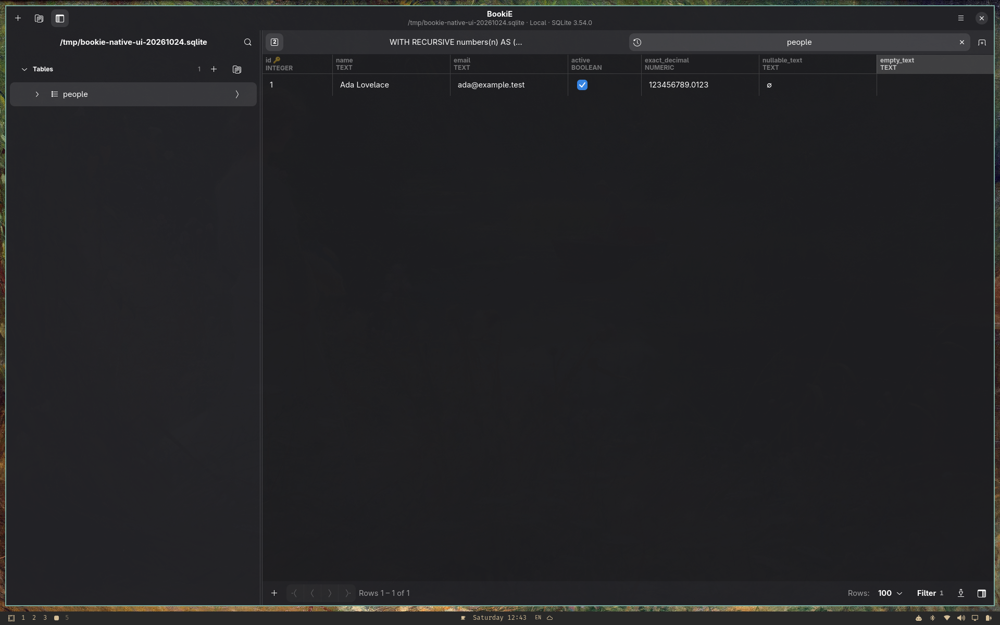
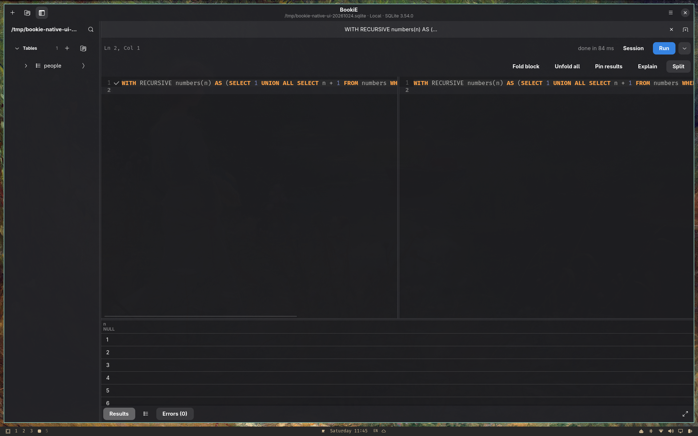
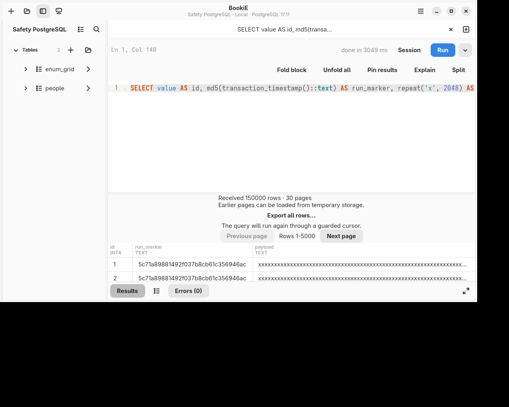
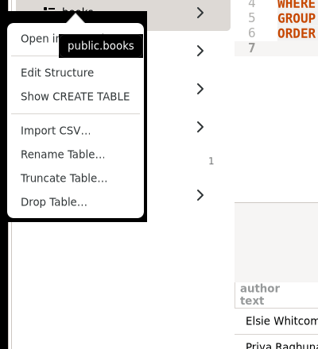
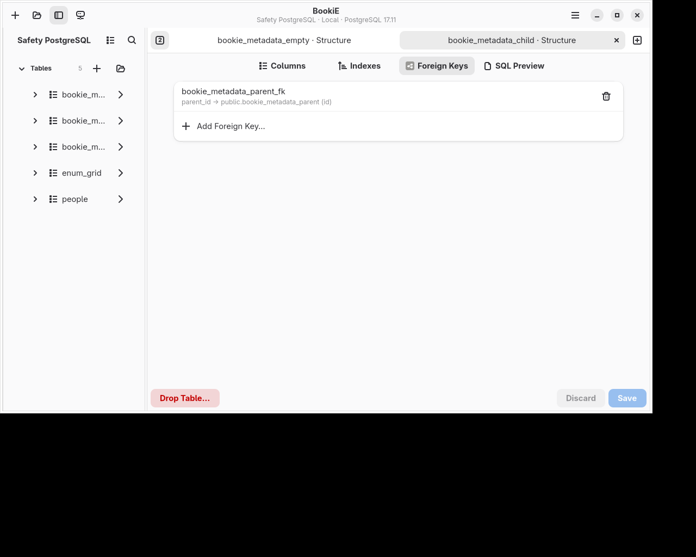
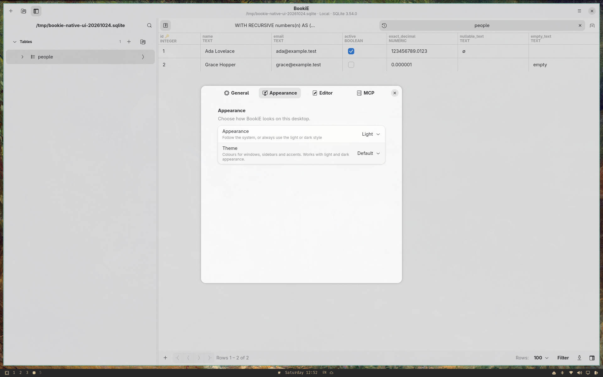

# BookiE features on `linux`

This page describes current behavior on the `linux` branch, including changes made after 0.2.0 was published. It does not certify that every listed feature is present in the [0.2.0 release assets](platforms.md#published-020-artifacts). Steps and shortcuts are in the [user guide](user-guide.md). Limits are in [known limitations](known-limitations.md). Per-engine capabilities are in the [driver maturity table](adding-drivers.md#driver-maturity).

## Databases

| Engine | Maturity | Notes |
|---|---|---|
| PostgreSQL | Stable | Broadest test coverage, including server-confirmed cancellation and verified TLS through SSH. |
| MySQL and MariaDB | Stable | Unix socket connections are supported. |
| SQLite | Stable | File based. Additional database files can be attached under custom schema aliases. |
| SQL Server | Stable | Kerberos sign-in is available. |
| ClickHouse | Stable | Mutations are awaited, so saved edits show up in the grid. |
| MongoDB | Experimental | Collections, find and aggregate. An optional authentication database can be set. |
| Redis | Experimental | One host and port. Sentinel and Cluster are not supported. |
| DuckDB | Experimental | Only in builds made with `--features duckdb`. Not in the released packages. |

Drivers are linked at build time. There is no plugin system ([ADR 0001](decisions/0001-no-plugin-system.md)).

## Connect

- Saved connections keep passwords in the desktop keyring (Secret Service), not in BookiE's own files.
- SSH tunnels use the built-in client or the system OpenSSH. BookiE asks before trusting an unknown host key.
- TLS has several strictness levels, up to checking both the certificate authority and the host name.
- Each connection has an environment: Local, Dev, Staging or Prod. A Prod connection shows a red badge, a tinted header and `[Production]` in the window title.
- A read-only connection refuses every change.
- SQLite connections support attaching additional database files under custom schema aliases, enabling cross-schema queries and unified catalog browsing.
- A connection can be filled from a URL such as `postgres://user@host:5432/db`.
- Connections can be exported and imported. An export encrypted with a passphrase includes stored credentials. A plaintext export contains none.

## Browse and edit tables

<picture>
  <source media="(prefers-color-scheme: dark)" srcset="images/browse-dark.png">
  
</picture>

- Click a table to open it in a preview tab. Edit or keep the tab to make it permanent.
- Tables are read in bounded pages. Deep forward navigation uses primary-key seeks where supported; previous-page, last-page and explicitly sorted paths may use offsets on some engines. See [known limitations](known-limitations.md#data-and-values).
- Edit a cell with a double-click, F2 or Enter. Edits stay pending, with a dot on the tab, until Ctrl+S. Undo and redo apply to pending edits.
- Insert rows, delete rows and set a cell to NULL. Changes are saved in one transaction where the engine supports it.
- NULL, empty text and unsupported values look different. Booleans show a check box with a third state for NULL. Sparse document fields that an object lacks show as (missing) and remain distinct from NULL.
- The header shows each column's type. Primary key columns have a key mark, foreign key columns a link mark, and a column comment appears under the name.
- Filter with the filter bar, and save filters by name per table. Sort by clicking a header.
- Foreign key navigation is bidirectional: **Go to Referenced Row** opens the parent table, and **Show Referencing Rows** navigates to matching child records in referencing tables with pre-populated filters.
- Copy selections in multiple formats: CSV, CSV with headers, Markdown, Text Table (aligned ASCII borders with right-aligned numeric cells), JSON Lines, and Values List (SQL multi-row tuples with dialect-specific syntax).
- Hide and reorder columns, and reset dragged column widths. The choice is remembered per table.
- Long cells over 8 KiB show a preview and byte count. **View Value** displays up to 1 MiB rendered text or 16 KiB hex. **Copy Value** copies complete values. Eligible text and JSON cells can be edited in the full-value dialog with semantic JSON formatting.
- The row inspector lists every column and its type. Selection statistics show count, sum, average, min, and max across numeric columns.

### Filters and search

## Write SQL

<picture>
  <source media="(prefers-color-scheme: dark)" srcset="images/sql-editor-dark.png">
  
</picture>

- Ctrl+E opens an editor tab. Ctrl+Enter runs the selected text, or the whole script when nothing is selected. Ctrl+Shift+Enter runs the statement at the cursor. Escape cancels a running query when the server supports it.
- Syntax highlighting, code folding and a side-by-side split of the same query.
- Completion offers keywords, tables after `FROM` and `JOIN`, and the columns of the tables named in the statement. `alias.` and `table.` narrow the list. Chosen names are inserted quoted for the engine.
- Bound parameters: Write `:name` in queries; BookiE prompts for typed values before execution without string concatenation.
- Progressive streaming: Single-statement PostgreSQL `SELECT`s stream within an estimated 64 MiB row budget; overflow pages spill to a local encrypted spool so previous pages remain revisitable without re-running SQL. The newest page and the page currently being viewed remain in memory while later pages arrive; if a stream times out or is cancelled, received pages stay selected.
- Local sort and filter: Sorting and filtering loaded query results are local and do not re-execute SQL.
- Session mode: Binds tabs to dedicated connections for temporary tables and transactions, displaying live transaction state.
- Visual explain plans: PostgreSQL displays execution trees with relative cost bars; SQLite displays indented trees.
- Timeout retry: Queries that hit timeouts offer an instant extended retry button.
- Query history & favorites: Toggle history with `Ctrl+H`, save favorites with `Ctrl+D`, view favorites with `Ctrl+Shift+B`, and use Open Quickly with `Ctrl+P`.

### Split editor and streaming

<picture>
  <source media="(prefers-color-scheme: dark)" srcset="images/stream-pager-dark.png">
  
</picture>

## Tables and structure

The sidebar table menu has Edit Structure, Show CREATE TABLE, Show ER Diagram, Import CSV, Rename Table, Truncate Table and Drop Table.

- Edit Structure has tabs for columns, indexes and foreign keys, and an SQL Preview tab.
- Rename Table is refused while the table has open tabs, so no pending change is lost.
- Truncate Table asks for confirmation and runs through the same guard as every other statement. SQLite does not support it.
- Show ER Diagram (also on a schema row) draws the schema's tables as cards with their columns, key badges and foreign-key relations. It reads at most 150 tables with the connection's metadata calls, under the operation timeout, and can be cancelled. Pan by dragging, zoom with the buttons or Ctrl+scroll, and pick a table in the list to centre it. Cards are laid out automatically; they cannot be moved, and the diagram cannot be exported yet.

## Import and export

- Export a table page or a query result as CSV, JSON, Markdown, HTML, XML, SQL or an Excel workbook.
- CSV export can protect cells that start like formulas, and can keep plain numbers unprotected so they import back into numeric columns.
- Import CSV into an existing table, or create a new table from a CSV file. Separator, header row and column mapping are detected and can be changed. The quote character, backslash escaping and file encoding (UTF-8, Windows-1252, UTF-16) can be set.
- Import accepts Excel `.xlsx` files. The first worksheet with data is read.
- Mappings can be remembered per connection and table.

## Safety and records

- Every statement is checked before it runs. Writes on a read-only connection are refused.
- Depending on the environment and policy, risky statements ask for approval first.
- Governed operations record terminal outcomes in a local audit journal. Operations that require audit persistence are refused when it is unavailable; an explicit Local/Dev policy can allow a human write after audit-intent failure, so that write may not be recorded.
- Values are never silently changed. An unsupported value stays visible as unsupported ([ADR 0007](decisions/0007-type-and-value-preservation.md)).

## PostgreSQL backup and restore

Back Up Database and Restore from Backup in the app menu use the installed `pg_dump` and `pg_restore`. They use the connection's configured SSH and TLS route. Restore requires a writable connection and approval, and both operations are audited.

## AI agents (MCP)

BookiE can let an AI assistant use saved connections through the Model Context Protocol. A token is created in Preferences, and limits which connections and which tools it may use. Every MCP request goes through the same policy guard as the desktop app. The headless `bookie-agentd` process serves MCP without a window. Data responses use a tagged value format that keeps wide integers exact ([user guide](user-guide.md#ai-agents-mcp)).

## What BookiE does not include

- No account, hosted service or paid tier.
- No browser interface and no runtime driver plugins.
- No database snapshots. [ADR 0015](decisions/0015-database-snapshots.md) records the accepted design; snapshots are not available in the current application.
- Linux only ([platforms](platforms.md)).

Detailed behavior, keyboard shortcuts, and limits are documented in the [user guide](user-guide.md) and [known limitations](known-limitations.md).
