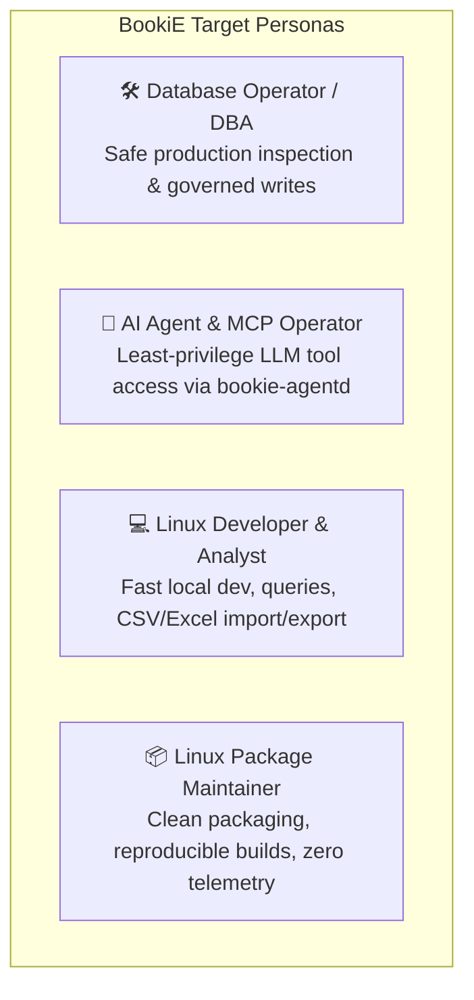

# User contexts

These role descriptions identify the workflows and constraints the product must support. They are design tools, not demographic profiles or claims about every user. Product rules remain in [PRODUCT.md](../PRODUCT.md) and accepted [ADRs](decisions/README.md).

| Context | Typical task | Important constraints |
|---|---|---|
| **Database operator** | Connect to a database, inspect schemas and rows, run SQL, and make controlled changes. | Local operation, explicit query outcomes, preserved values, safe credential storage, and clear limits when the engine cannot provide an exact result. |
| **MCP operator** | Configure a local agent process to access selected database tools. | Least-privilege token scopes, connection allowlists, rate limits, policy checks, result masking, and auditable outcomes. |
| **Linux developer** | Query local and staging databases, import datasets, test SQL scripts, prototype data models. | Instant keyboard shortcuts, responsive non-blocking UI, syntax completion, split query editing, and accurate data typing. |
| **Package maintainer** | Build, inspect, and distribute application packages across Linux distributions. | Reproducible inputs, dependency notices, correct package contents, and compatibility with existing identifiers and user data. |

---

### 1. Database Operator & DBA
- **Environment**: Wayland / X11 on Arch, Fedora, Debian, or Ubuntu.
- **Workflow**: Manages PostgreSQL, MySQL, ClickHouse, or SQL Server instances over SSH bastions and TLS. Relies heavily on visual environment flags (`[Production]` red header tint) to prevent accidental data destruction.
- **Critical Requirements**:
  - Destructive statements (`DELETE` without `WHERE`, `DROP TABLE`, `TRUNCATE`) must prompt for human approval.
  - Server-side cancellation must reliably propagate to the engine on Escape.
  - Audit journal must record every write and failed attempt locally.

### 2. AI Agent & MCP Operator
- **Environment**: Local CLI, Claude Desktop, Cursor, or autonomous agent runners.
- **Workflow**: Launches `bookie-agentd` as an MCP server to let AI assistants query database metadata, inspect schemas, and preview queries.
- **Critical Requirements**:
  - Multi-boundary defense: Token scope check ➔ Connection allowlist ➔ PolicyGuard classification.
  - Headless daemon must never open raw driver connections or bypass SQL policy.
  - Cell values must use lossless tagging (`bookie-tagged-v1`) so wide 64-bit integers and exact decimals never lose precision.

### 3. Linux Developer & Data Analyst
- **Environment**: Linux desktop workstation running local Docker containers, SQLite databases, or embedded DuckDB.
- **Workflow**: Writes queries, reviews explain plans, pastes tab-separated spreadsheet data directly into table cells, and exports results to CSV or Excel.
- **Critical Requirements**:
  - Instant startup with zero network dependencies or remote login gates.
  - Keyset-seek table browsing with pending edit review before commit.
  - Side-by-side SQL query editor with code folding and autocompletion.

### 4. Linux Package Maintainer
- **Environment**: Arch PKGBUILD, Debian package tooling, Flatpak runtimes (GNOME 51 SDK), and Meson build systems.
- **Workflow**: Builds reproducible binaries from source tags, packages application metadata, icons, and shell completions.
- **Critical Requirements**:
  - Adherence to XDG Base Directory specification (`$XDG_CONFIG_HOME`, `$XDG_DATA_HOME`).
  - No bundled proprietary libraries; all drivers statically linked at Cargo compile time.
  - Safe upgrades and rollbacks without breaking desktop keyring credentials.

---

## Design checks

- Can the workflow complete locally without account creation or remote entitlement checks?
- Does the interface distinguish an empty value, SQL NULL, an unsupported value, and an unknown operation outcome?
- Can the user tell which records are loaded, filtered, truncated, pending, or still being processed?
- Does cancellation reach the database operation, and does the result describe uncertainty honestly?
- Can an agent access only the tools and connections granted to its token while still passing through SQL policy?
- Can a package be upgraded or rolled back without changing the application's stored identity or deleting user data?

These checks inform product and architecture decisions. They do not replace the regression tests, driver fixtures, or installed desktop acceptance required by [AGENTS.md](../AGENTS.md).
