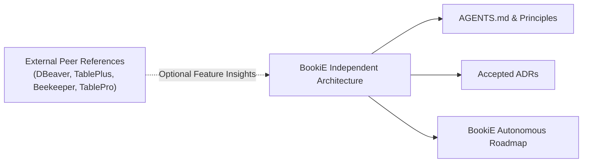

# External peer references and client review

BookiE is an independent, autonomous Rust and GTK database client. It maintains no ongoing upstream dependencies, synchronization requirements, or upstream tracking workflows. Other database clients (such as TablePro, DBeaver, TablePlus, Beekeeper Studio, and dbx) are reviewed strictly as external peer references for user expectations, standard SQL behaviors, driver quirks, and desktop UX ideas. Accepted ADRs and BookiE's maintainers exclusively decide all design, architecture, and roadmap choices.

## Current reviews

- The [October 23 database-client review](archive/database-client-review-2026-10-23.md) records source and release pins, corrections to older pagination advice and candidate follow-ups.
- The [October 21 TablePro adoption review](archive/tablepro-collaboration-2026-10-21.md) records its inspected source, Linux changes and contribution candidates.
- Earlier source and issue snapshots are preserved in the [upstream review archive](archive/upstream-sync-history-2026-10-22.md). Their issue and pull request states are historical.

Use the [backlog](backlog.md) and owning issues to select work. Research findings do not establish that a defect exists, that a feature is accepted, or that a change belongs in a release.

## Review method

For each candidate, record the reference repository and exact commit or release, the behavior and its reason, the matching BookiE path, existing coverage, Linux applicability, license and attribution, owner, and acceptance layer. Confirm the case against BookiE source before proposing a change.

Keep PolicyGuard, audit, storage, GTK ownership, session and driver boundaries intact. Manually implement only behavior that applies to Linux. Do not copy platform framework code or remove a local dependency patch without a separate decision and equivalence evidence. Add a regression test that observes the behavior, then link the change and its proof from the owning issue.

Review is purely optional. Routine BookiE development does not need an external comparison.
