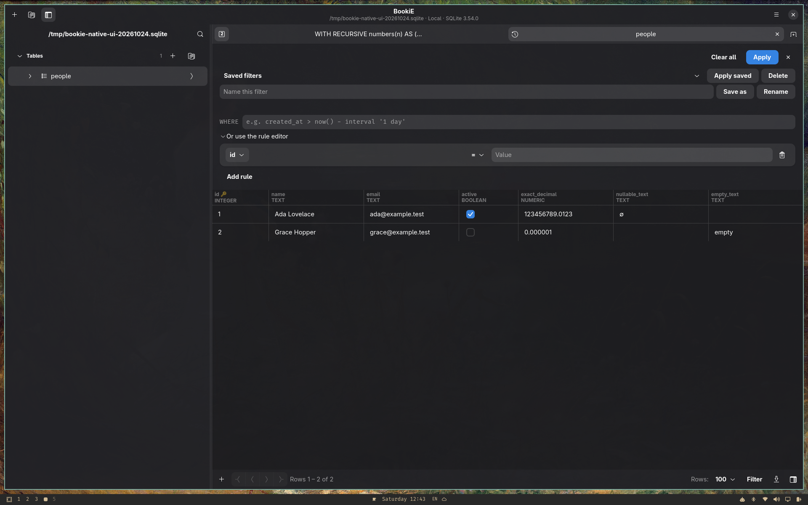
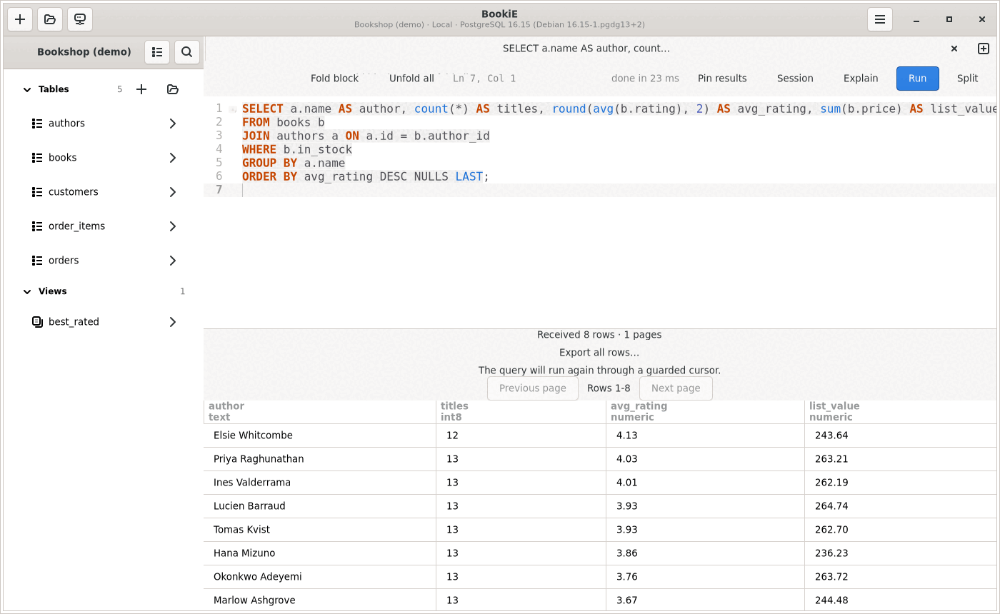
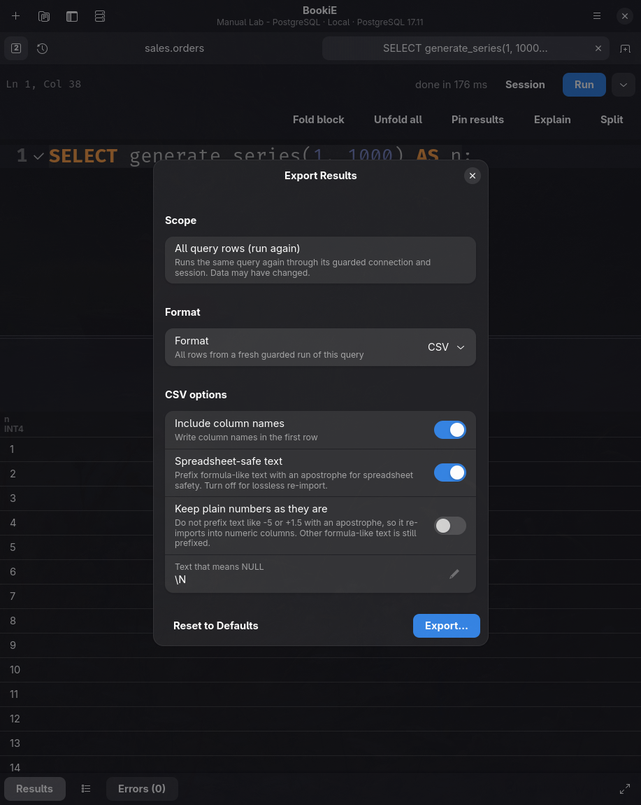
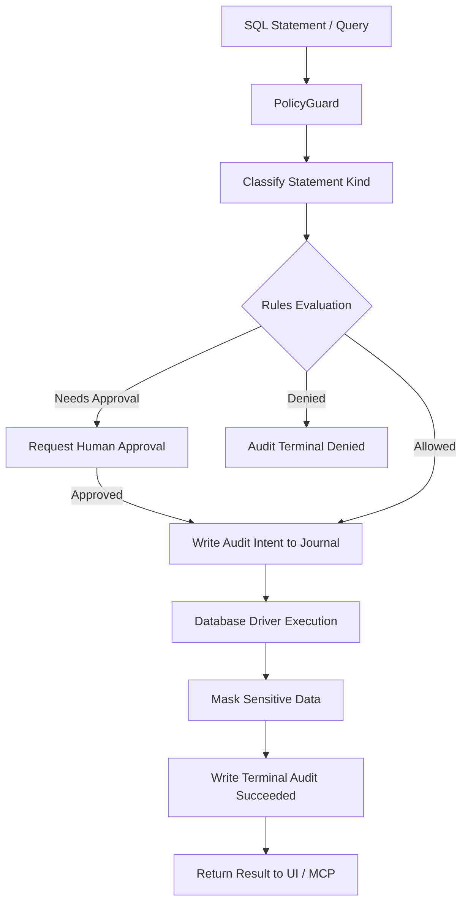
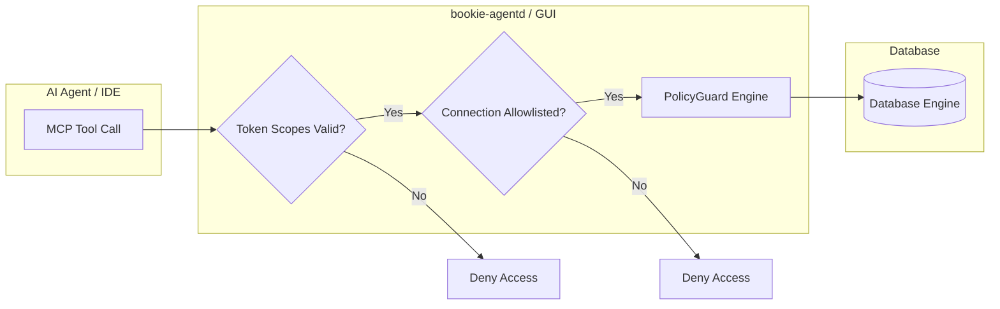

# BookiE user guide

BookiE is a database client for Linux. It opens PostgreSQL, MySQL and MariaDB, SQLite, SQL Server, ClickHouse, MongoDB, Redis and (when built with it) DuckDB. This guide covers everyday use. Developer documentation starts at [docs/README.md](README.md).

## Connect


1. Click **New connection** (the `+` in the header), or use **Add Connection**, **Import from URL…**, or **Import connections…** on a fresh profile.
2. Pick the database engine, then enter host, port, database, and user (or select the database file for SQLite / DuckDB).
3. Click **Test** to verify connectivity, then **Connect**.

### Connection options

- **Socket connections**: For MySQL, MariaDB, or PostgreSQL, specify a local Unix socket file (e.g. `mysql://user@/db?socket=/run/mysqld/mysqld.sock`).
- **SSH tunneling**: Configure an SSH bastion host. BookiE verifies host keys against `$XDG_CONFIG_HOME/tablepro/known_hosts` and prompts before trusting unknown keys.
- **TLS verification**: Select verification strictness, up to **Verify full** (validates certificate authority and host identity).
- **Environment markers**: Tag connections as **Local**, **Dev**, **Staging**, or **Production**. Production connections display a red badge, a tinted header, and `[Production]` in the window title.
- **Keyring security**: Passwords stay in the desktop keyring (Secret Service via `oo7`). Plaintext connection files never store credentials.
- **CLI launch**: Open databases directly from a terminal: `bookie books.db` or `bookie postgres://user@host:5432/db`.
- **Attached SQLite databases**: The SQLite driver can use configured attachments, but the connection form does not currently provide controls to add or edit them. Existing attachment lists are preserved when editing the same connection.
- **Bundles**: Export or import connections with optional passphrase encryption to share configurations across machines.

## Browse a table

<picture>
  <source media="(prefers-color-scheme: dark)" srcset="images/browse-dark.png">
  
</picture>

Click any table in the sidebar to open it in a preview tab. Editing the table or selecting **Keep Tab** makes it permanent.

Navigation uses **First**, **Previous**, **Next**, and **Last**. Unsorted tables with primary keys use fast keyset seeks.



### Grid operations

- **Edit cells**: Double-click or press F2/Enter. Changes remain pending (marked with a dot on the tab) until saved with `Ctrl+S`. Preview the exact SQL changes before saving. Undo and redo with `Ctrl+Z` / `Ctrl+Y`.
- **Insert and delete**: Press `Ctrl+N` to insert a row, `Delete` to remove selected rows, and `Ctrl+Shift+N` to set a cell to NULL.
- **Filter and sort**: Press `Ctrl+F` to open the structured filter bar. The WHERE field, **Saved filters** menu, **Clear all**, and **Apply** share one row, with the rule editor available under disclosure. Save named filter presets per table. Right-click any cell to **Filter by This Value**. Click column headers to sort.
- **Foreign key jumps**: Right-click a foreign key cell and choose **Go to Referenced Row** to open the target table filtered to that specific record.
- **Referencing rows**: Right-click a saved row in a table with detected incoming foreign keys and choose **Show Referencing Rows** to open matching child records with pre-populated filters. The action is unavailable for new draft rows; referenced values must be present and non-NULL.
- **Copy as formats**: Right-click a row selection and choose **Copy as** to copy complete selected rows as **CSV**, **CSV (with headers)**, **Markdown**, **Text Table** (aligned ASCII borders with right-aligned numeric cells), **JSON Lines** (newline-delimited JSON objects), or **Values List** (multi-row SQL tuples with engine-specific escaping).
- **Paste rows**: Paste tab-separated spreadsheet data (`Ctrl+V`) directly into cells. Each value is type-checked before staging.
- **ENUM & SET pickers**: Double-click an ENUM or SET cell to open a dedicated item selection popover with an **Apply** button.
- **Long values & JSON**: Cells over 8 KiB show a preview and size. Right-click to **View Value** (up to 1 MiB text / 16 KiB hex) or **Edit Full Value…** with automated JSON formatting.
- **Row inspector & statistics**: View all columns and data types in the side inspector. Select multiple rows to view aggregate count, sum, average, min, and max.

## Show an ER diagram

Right-click a schema, or a table, in the sidebar and choose **Show ER Diagram**. BookiE reads the tables of that schema (up to 150, with a notice if there are more) and draws each as a card with its columns, primary-key and foreign-key badges, and a line for every foreign key. Cancel the read with **Cancel** or by closing the window. Drag to pan; use **+**, **-**, **0**, the arrow keys or Ctrl+scroll to zoom and move; click a card or a name in the list on the left to select it and see what it references. Engines that do not report foreign keys show the tables without relations.

## Run SQL

<picture>
  <source media="(prefers-color-scheme: dark)" srcset="images/sql-editor-dark.png">
  
</picture>

In a focused result grid, **Ctrl+Shift+J** opens **Jump to Column** and **Ctrl+Alt+F** opens **Find in Loaded Rows**. **Ctrl+Home** and **Ctrl+End** navigate to the first and last loaded rows.

### Editor controls

- **Open editor**: Press `Ctrl+E` or `Ctrl+T` to open a SQL tab.
- **Split editor**: Click **Split** in the toolbar to edit side-by-side with shared carets and independent scroll.
- **Code folding**: Press `Ctrl+Shift+[` inside any block to fold it; `Ctrl+Shift+]` or the gutter markers unfold blocks.
- **Autocompletion**: Context-aware suggestions for keywords, schemas, tables, and columns.
- **Bound parameters**: Write `:name` in your query; BookiE prompts for typed values before execution without string concatenation.

### Query execution

- **Execute**: Press `Ctrl+Enter` (or click **Run**) to run selected SQL or the full buffer. Press `Ctrl+Shift+Enter` to run only the statement under the cursor.
- **Cancel**: Press `Escape` to cancel a running query where the driver supports it.
- **Timeout retry**: If a query times out, click **Run again** in the toolbar to run with an extended deadline once.
- **Error navigation**: Click **Go to error** on a failed statement to jump directly to the character location in your SQL.

### Progressive streaming & spooling

Single-statement PostgreSQL `SELECT` queries stream progressively:
- **In-memory cache**: Keeps pages within an estimated 64 MiB row budget.
- **Encrypted disk spool**: Evicted pages write to a local encrypted spool (up to 4,096 pages, 1 GiB quota), keeping earlier pages navigable via **Previous page** without re-running the query.
- Other statement shapes and database engines load capped results.

### Sessions, explain plans & history

- **Timeout retry**: When a query times out, click **Run again with a longer timeout** (4× duration) for an immediate one-shot extended run.
- **Side-by-side split & code folding**: Use **Split** to edit the query in two synced panes. Place the cursor and press `Ctrl+Shift+[` to fold a block, or use the toolbar's fold menu (`⋯`) to unfold.
- **Results & Errors switcher**: Results and Errors share a linked bottom switcher. Errors displays a badge count only when errors occur; click **Go to error** to jump directly to the failing statement position.
- **Session mode**: Toggle **Session** to bind the tab to a dedicated connection for transactions and temporary tables. When a transaction is active, use **Commit & close session** or **Roll back & close session**.
- **Explain plans**: Click **Explain** to inspect execution plans. PostgreSQL displays a visual **Tree** with cost-distribution bars alongside raw text; SQLite provides an indented tree.
- **Query history**: Press `Ctrl+H` to toggle the bottom history drawer. Statements containing secrets are automatically excluded.
- **Favorites & Open Quickly**: Press `Ctrl+D` to save a favorite query, `Ctrl+Shift+B` to view saved favorites, and `Ctrl+P` for Open Quickly across tabs, favorites, and connections.

## Import and export



- **Export**: Select **Scope** (Current table page or loaded query result) before choosing your format: CSV, JSON, Markdown, HTML, XML, SQL, or Excel (`.xlsx`). Full-table unindexed snapshot exports remain unavailable until a consistent snapshot path is supported.
- **Import**: Right-click any table and choose **Import CSV…**, or import from a schema header to create a new table. Excel `.xlsx` files read the first populated sheet. Delimiters, headers, encodings (UTF-8, Windows-1252, UTF-16), and column mappings are detected automatically and can be remembered per table.

## Safety

BookiE checks every statement before it runs:



- Writes on a read-only connection are refused.
- Depending on the connection's environment and your policy, risky statements (for example a `DELETE` without `WHERE`, or schema changes in production) ask for your approval first. The time spent waiting for approval is not counted in the statement's elapsed time.
- BookiE records governed operation outcomes in a local audit journal when it is available. MCP and operations that require audit persistence are refused if the journal is unavailable. A Local or Dev policy may allow a human write to continue after audit-intent failure; that write may succeed without being recorded.

## Back up and restore PostgreSQL

From the app menu, choose **Back Up Database…** to save a custom-format `.dump` file, or **Restore from Backup…** to restore one. These actions are available for PostgreSQL connections and use the installed `pg_dump` and `pg_restore` tools. The tools' major version is checked against the server's: `pg_dump` must be the same major version as the server or newer, and `pg_restore` must be the same or older. With PostgreSQL 18 client tools and a version 16 server, a backup works and a restore is refused with "pg_restore 18 is newer than the server (16); install the matching client"; install client tools that match the server to restore. They work over the connection's configured SSH and TLS route. Restore requires a writable connection and approval; both operations are audited. Cancel stops the running tool. Cancelling a backup removes its partial file. If a restore is cancelled or fails after `pg_restore` starts, the result is unknown. BookiE records that outcome and keeps governed writes blocked on that connection, including after reconnect; other connections remain available. There is not yet an in-app action to reconcile it. Check the database state before deciding how to proceed.

## Snapshots

Database snapshots are not available. [ADR 0015](decisions/0015-database-snapshots.md) records the accepted design. PostgreSQL logical backup and restore are available separately; see [Back up and restore PostgreSQL](#back-up-and-restore-postgresql).

## AI agents (MCP)

BookiE can let an AI assistant use your saved connections through the Model Context Protocol. Open **Preferences → MCP** to create a token, choose which connections it may use and which tools it may call.



The token appears once; the dialog reports whether it was saved in the system keyring. If saving fails, copy it into your MCP client configuration before closing the dialog. Every agent statement goes through the same safety checks, and agent changes follow the approval rules of the connection's environment. `bookie-agentd` runs the same server without the window, for headless use.

Open **Audit Log** from the main menu to review persisted operation records. Each record shows its connection, principal, kind, outcome, row count and duration, and expands to its operation id, policy rule, stored statement and error. Statement text appears in the redacted form the journal keeps. A Local or Dev policy may allow a human write to continue after audit-intent failure without a persisted record; see [Safety](#safety).

MCP data responses use the versioned `bookie-tagged-v1` format. Check `value_format` and decode each cell by `$type`; values are tagged even when they fit in a JSON number. A wide integer is returned like this:

```json
{"$type":"int64","value":"9007199254740993"}
```

Keep the digits as text or parse them with a lossless integer type. Parsed JSON uses nested tags, including `json_number` values whose digits stay strings. `json_text` contains the original JSON text; keep it as text when duplicate keys, whitespace or number spelling matter. Clients that expect primitive JSON cells must update their decoder. CSV exports keep their existing format.

The tool list carries read-only and destructive hints for MCP clients. Only the table and metadata tools are marked read-only. Tools that run SQL are marked as able to change data, even when they preview first. The hints are advisory: they never grant a permission and the safety checks still decide every call.

## Keyboard shortcuts

Press Ctrl+? for the full list. The most used:

| Keys | Action |
|---|---|
| Ctrl+E / Ctrl+T | New SQL editor tab |
| Ctrl+Enter | Run the selection, or the script when nothing is selected |
| Ctrl+Shift+Enter | Run the statement at the cursor |
| Ctrl+S | Save pending changes (or the SQL file) |
| Ctrl+Z / Ctrl+Y | Undo / redo a pending change |
| Ctrl+F | Filter rows |
| Ctrl+Alt+F | Find in loaded rows |
| Ctrl+Shift+J | Jump to a column |
| Ctrl+Shift+L | Reveal the open table in the sidebar |
| Ctrl+D | Save query as favorite |
| Ctrl+Shift+B | Open saved queries (favorites) |
| Ctrl+P | Open Quickly |
| Ctrl+H | Query history |
| Ctrl+Tab | Most recently used tab |
| Ctrl+/ | Toggle a line comment |
| Ctrl+Shift+[ | Fold the SQL block at the cursor |
| Ctrl+Shift+] | Unfold all SQL blocks |
| F5 | Refresh the table |
| Ctrl+W | Close the tab |

### Results panel

Each SQL editor keeps its own bottom panel. **Results** or **Ctrl+J** hides or shows it from the SQL editor or result grid. Hiding preserves the loaded rows, selection and current result set; it does not run SQL. **Results** and **Errors** are one switcher with the active view marked: choosing **Results** while Errors is shown returns to the existing result selector, and choosing it again hides the panel. **Errors** shows a count only when the latest run failed, and lists failures from the latest completed run, including streamed failures and timeouts; informational server messages are not implemented by this panel.

Drag the divider to resize the panel. **Maximize results** hides the SQL area; **Restore editor** returns to the previous divider position and SQL focus. Hiding a maximized panel also restores the editor. Panel size is retained within the open editor, not across an application restart. Closing the query releases its panel with the rest of that editor.
