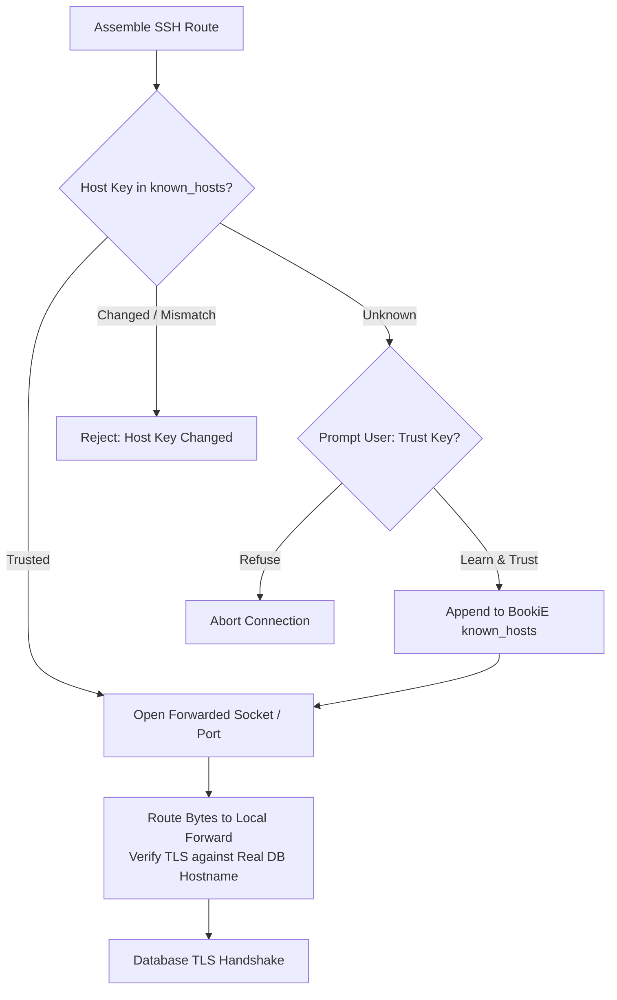

# SSH transport

This specification describes the SSH transport contract. Source and tests are authoritative for implementation details.

**Spec tier:** buildable **Serves:** `Local DBA` **Specification:** draft **Success metric:** A tunnel opens only after the host key is trusted or explicitly learned; TLS still verifies the saved database hostname, not loopback.

## Purpose

Turn a saved SSH hop into a local forward, and decide whether an unknown or changed host key is trusted. Preserve the service hostname used for certificate verification so a tunnel is not a TLS downgrade.

## Scope

- Built-in `russh` tunnels and the optional system OpenSSH backend (`crates/ssh`).
- Host-key outcomes: trusted, learned, changed, unknown, known_hosts I/O failure (`crates/ssh/src/known_hosts.rs`).
- `UnknownHostKey::{Learn, Refuse}` (`crates/ssh/src/lib.rs`).
- Transport assembly: saved connection to driver options, SSH chain, tunnel, TLS service identity (`crates/transport`, [ARCHITECTURE](../../ARCHITECTURE.md#transport-and-service-identity)).
- Independent per-hop credential resolution and connection-material identity (`crates/transport`).

## Out of scope

- What SQL may run after the driver connects ([governed-sql](../governed-sql/spec.md)).
- Secret Service storage details for hop passwords and key passphrases ([secret-storage](../secret-storage/spec.md), ADR 0004).
- Whether a package enables the optional OpenSSH backend.

## Core concepts



- **Dial target.** Where bytes are sent (forwarded socket or `127.0.0.1:ephemeral`).
- **TLS service identity.** The hostname the certificate must match (the saved database host).
- **BookiE known_hosts.** The built-in backend reads and writes `default_known_hosts_path` (an absolute `$XDG_CONFIG_HOME/tablepro/known_hosts`, or `~/.config/tablepro/known_hosts` when XDG_CONFIG_HOME is absent, empty or relative). System `~/.ssh/known_hosts` is unused by that backend.

## Data contracts

`UnknownHostKey` (`crates/ssh/src/lib.rs`):

```text
Learn
Refuse
```

`HostKeyOutcome` (`crates/ssh/src/known_hosts.rs`):

```text
Trusted
LearnedNew { fingerprint }
Changed { fingerprint, line }
Unknown { fingerprint }
KnownHostsIo(String)
```

`SshError` host-key variants (`crates/ssh/src/lib.rs`):

| Variant | When |
|---|---|
| `HostKeyMismatch { host, port, new_fingerprint, line, known_hosts }` | Stored fingerprint differs. |
| `UnknownHostKey { host, port, fingerprint, known_hosts }` | Key is absent and this connection does not add keys. |
| `KnownHosts(String)` | The known_hosts file could not be read or updated. |

The OpenSSH backend forces `StrictHostKeyChecking=ask` in its private config and master argv. Prompt kinds include `HostKeyConfirmation { host, algorithm, fingerprint }`.

## Interface contracts

### `verify_or_learn`

`verify_or_learn` in `crates/ssh/src/known_hosts.rs`. Returns `HostKeyOutcome`, not `SshError`.

- Known matching key → `Trusted`.
- Unknown key and `UnknownHostKey::Refuse` → `Unknown`.
- Unknown key and `Learn` → write the key, then `LearnedNew` or `KnownHostsIo`.
- Changed key → `Changed` (never overwritten in this function).

`connect_and_auth` maps `Unknown` to `SshError::UnknownHostKey` and `Changed` to `SshError::HostKeyMismatch`. Transport surfaces some of those as `TransportError::HostKeyRefused`.

### `verify_or_prompt`

`verify_or_prompt` in `crates/ssh/src/known_hosts.rs`.

- Known matching key → `Trusted`.
- Unknown key → prompt. `PromptAnswer::Accept` records the key. Any other answer → `Unknown`.
- Changed keys and known_hosts I/O errors return their refusal outcome without prompting.

### Transport identity

`ConnectOptions` keeps dial fields (`host`, `port`, `forwarded_socket_dir`) separate from `service_endpoint`. SSH + Verify CA/Full uses a Unix socket in a private directory when the driver reports a forwarded socket name; otherwise TCP. TLS verifies the saved database hostname via `service_address()`, not the local dial host. Unsupported combinations fail closed. [ARCHITECTURE](../../ARCHITECTURE.md#transport-and-service-identity).

| Endpoint | Status | errorCode | Message / condition |
|----------|--------|-----------|---------------------|
| built-in verify | n/a | `HostKeyMismatch` | Fingerprint differs; line cited in `known_hosts`. |
| built-in verify | n/a | `UnknownHostKey` | Absent key and `Refuse`; running system `ssh` will not write this file. |
| built-in verify | n/a | `KnownHosts` | I/O or parse failure on the BookiE known_hosts file. |
| OpenSSH backend | n/a | `HostKeyUnknown` / `HostKeyChanged` / `HostKeyRevoked` | Classified from OpenSSH stderr (`classify` in `crates/ssh/src/openssh/stderr_classify.rs`; variants in `openssh/error.rs`). |

## Algorithms & rules

1. Resolve each saved hop's host, port, username and auth independently. Secrets remain wrapped until the SSH boundary.
2. Read BookiE `known_hosts` (default from `default_known_hosts_path`).
3. Compare the presented key.
4. A key marked `@revoked` for this host fails closed, even if it also matches a normal known-host entry. Match → continue. Change → fail with `HostKeyMismatch`. Missing + `Refuse` → fail with `UnknownHostKey`. Missing + `Learn` or an accepted prompt → append and continue.
5. Open the forward. Built-in russh timeouts in `crates/ssh/src/lib.rs`: `CONNECT_TIMEOUT` 10s, `AUTH_TIMEOUT` 20s, `KEEPALIVE_INTERVAL` 15s. Handshake 10s and keepalive 15s have tests; auth 20s is code-only. OpenSSH forces `ConnectTimeout=10` and `ServerAliveInterval=15`; handshake/auth deadlines live in `OpenSshTimeouts`.
6. Hand transport a local dial target plus the original service hostname for TLS.

OpenSSH: force `StrictHostKeyChecking=ask` for the destination and every `ProxyJump` hop. The private config places this setting before system and user config includes; `-F` lets OpenSSH pass the same config to its `ProxyJump` child. Classify host-key stderr. Do not set `accept-new` or `no`.

## State machine

| From | To | Trigger | Guard |
|------|----|---------|-------|
| unseen | trusted | key matches known_hosts | check succeeds |
| unseen | learned | unknown key, `Learn` or prompt Accept | write succeeds |
| unseen | refused | unknown key, `Refuse` or prompt decline | no write |
| unseen | mismatch | key changed | never overwrite |
| unseen | io-failed | known_hosts I/O error | fail closed |
| learned / trusted | forwarded | auth and channel succeed | connect/auth timeouts |
| forwarded | connected | driver dials the forward | TLS identity is the saved host |

## Requirements

- The system MUST compare the presented host key to BookiE `known_hosts` during handshake, before authentication and local forward bind (`ClientHandler::check_server_key`).
- A changed key MUST fail closed. The stored line MUST NOT be overwritten automatically.
- A key marked `@revoked` for this host MUST fail closed and MUST NOT be accepted, learned or prompted for.
- `UnknownHostKey::Refuse` MUST NOT add a key.
- System `ssh` writing `~/.ssh/known_hosts` MUST NOT be treated as trust for the built-in backend.
- TLS through an SSH tunnel MUST verify the saved database hostname when verification is requested.
- The OpenSSH backend MUST use `StrictHostKeyChecking=ask` for the destination and every `ProxyJump` hop, regardless of later system or user config settings.
- The OpenSSH backend MUST refuse an effective `ProxyCommand` for the destination or any hop; it supports configured `ProxyJump` routes without executing arbitrary configured commands.

## Invariants

- A changed host key MUST NOT be learned over the old line.
- A revoked host key MUST NOT be trusted, learned or prompted for.
- A Refuse connection MUST NOT create a new known_hosts entry.
- TLS identity MUST NOT become `127.0.0.1` merely because the dial target is a local forward.

## Config & flags

| Flag | Effect |
|------|--------|
| `UnknownHostKey::Learn` | First-seen keys may be written after the backend's learn/prompt path. |
| `UnknownHostKey::Refuse` | First-seen keys fail. |
| OpenSSH backend | Optional; still asks on unknown keys. Flatpak may refuse this backend entirely (packaging). |

## Edge cases

- Keyboard-interactive-only servers are unsupported (`SshError::KeyboardInteractiveUnsupported`).
- An empty jump chain is `SshError::EmptyChain`.
- OpenSSH host-key prompts are normalized to `HostKeyConfirmation`.

## Trust boundaries

- Host keys are a trust decision. A mismatch is treated as a possible on-path attack.
- Auth secrets (password, key passphrase, agent) stay in `secrecy` types until the SSH crate boundary.
- The known_hosts file is local trusted state. Corruption or I/O errors fail closed.

## Cross-capability interactions

### governed-sql

Transport returns a driver connection. Policy starts after that handle is wrapped.

## Acceptance criteria

- **Known key.** GIVEN a host key that matches BookiE known_hosts WHEN verify runs THEN the outcome is `Trusted`.
- **Refuse unknown.** GIVEN `UnknownHostKey::Refuse` AND no matching line WHEN verify_or_learn runs THEN the outcome is `HostKeyOutcome::Unknown` AND the file is unchanged.
- **Changed key.** GIVEN a stored key that does not match WHEN verify runs THEN the outcome is `Changed` and the old line is not overwritten.
- **Revoked key.** GIVEN a key marked `@revoked` for the host WHEN built-in verification runs THEN the connection is refused even if the key also appears in a normal entry, and no prompt or learn path runs.
- **Relative XDG config path.** GIVEN `XDG_CONFIG_HOME` is relative WHEN the built-in known-host path is resolved THEN the path falls back to `$HOME/.config/tablepro/known_hosts`.
- **Learn new.** GIVEN `UnknownHostKey::Learn` AND no matching line WHEN verify_or_learn succeeds THEN the outcome is `LearnedNew` AND a new line exists.
- **Prompt decline.** GIVEN verify_or_prompt AND the prompter does not accept WHEN the key is unknown THEN the outcome is `Unknown` AND no line is added.
- **TLS identity.** GIVEN SSH plus certificate verification WHEN transport assembles options THEN the TLS hostname is the saved database host, not the local forward.
- **OpenSSH ProxyJump policy.** GIVEN the system OpenSSH backend and a `ProxyJump` route WHEN BookiE starts the master THEN it applies `StrictHostKeyChecking=ask` to the destination and every hop, independent of later system or user configuration, and refuses effective `ProxyCommand` settings.
